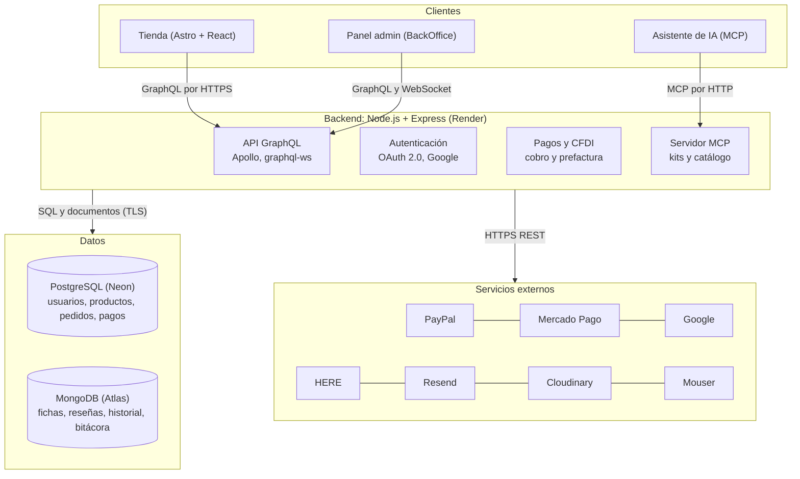
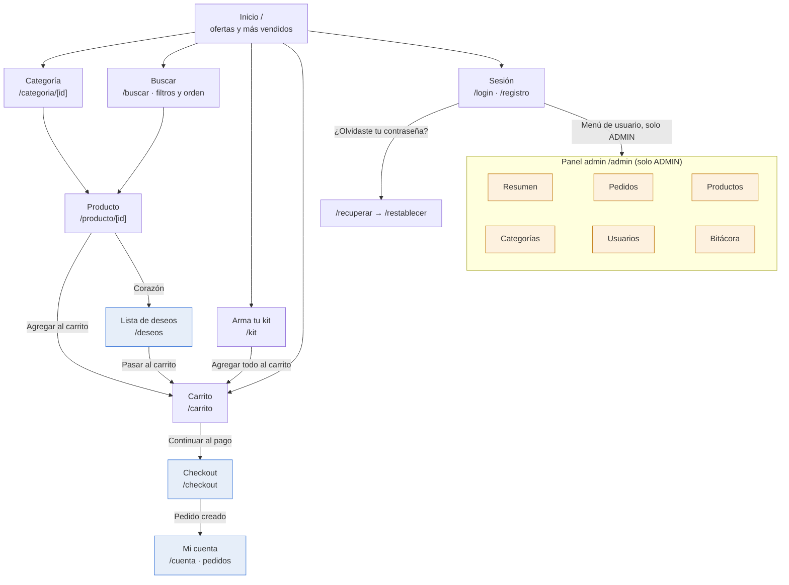
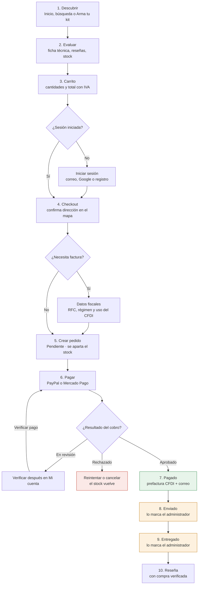
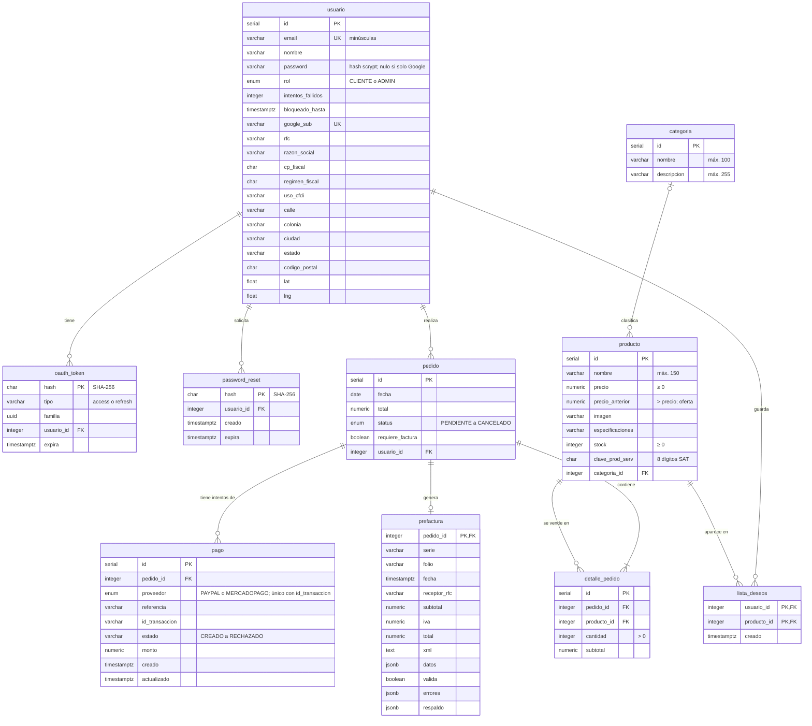

# Especificación de Requerimientos de Software (SRS) — Voltrix

20 de noviembre de 2026

| Campo | Valor |
|---|---|
| Nombre del proyecto | Voltrix: tienda en línea de componentes electrónicos |
| Participante(s) | Jesús Emir Ayala Rayo (23100140); Isaac Daniel Guzmán Chávez (23100123); Fernando Rodríguez Sánchez (23100130) |
| Asesor(es) | Octavio Villavicencio Cruz |
| Fecha y versión | 20 / 11 / 2026 - v1.0 |
| Repositorio | Ferklore/Voltrix-Final |

## 1. Introducción

La presente Especificación de Requerimientos de Software (SRS) proporciona una visión integral y estructurada de la información necesaria para comprender, desarrollar y verificar Voltrix. Incluye la terminología y las referencias utilizadas; una descripción global con la perspectiva, las funciones, las interfaces, los usuarios y las restricciones; los requisitos específicos con su matriz de trazabilidad; las interfaces externas, y los requisitos de diseño del sistema con sus restricciones de diseño. Los apéndices complementan la información sin formar parte directa de la especificación: modelo de datos, formatos de entrada y salida, análisis de mercado, análisis FODA y brief de diseño.

### 1.1 Descripción breve del producto

Voltrix es una tienda en línea de componentes electrónicos (microcontroladores, sensores, pantallas y módulos) para estudiantes, aficionados y desarrolladores de proyectos. Permite consultar un catálogo con fichas técnicas, armar kits según el proyecto y el presupuesto, comprar con PayPal o tarjeta mediante Mercado Pago y obtener una prefactura con la estructura del CFDI 4.0. Un panel de administración en tiempo real permite gestionar inventario, pedidos, usuarios y la bitácora del sistema. La categoría de productos (SFW) del equipo es la de componentes electrónicos para proyectos: microcontroladores, sensores, pantallas y módulos, con contenido apto para todo público.

### 1.2 Definiciones, siglas y abreviaciones

| Término | Definición |
|---|---|
| Access token | Credencial opaca de 1 hora que autoriza las peticiones de una sesión. |
| ADMIN | Rol de usuario con acceso al panel de administración (BackOffice). |
| API | Application Programming Interface. Conjunto de operaciones que un sistema expone a otros programas. |
| Astro | Framework web que genera las páginas de la tienda en el servidor. |
| BackOffice | Panel de administración de la tienda, ubicado en /admin. |
| Bitácora | Registro de eventos del sistema (pedidos, pagos, accesos, correos) que se conserva 90 días. |
| Card Payment Brick | Componente de Mercado Pago que captura la tarjeta dentro del checkout y la convierte en un token. |
| Carrito | Lista temporal de productos que el cliente desea comprar, guardada en el navegador. |
| CFDI | Comprobante Fiscal Digital por Internet, definido por el SAT en el Anexo 20. |
| CI/CD | Integración y despliegue continuos. En Voltrix se ejecutan con GitHub Actions. |
| CLIENTE | Rol de usuario que compra en la tienda. |
| Cloudinary | Servicio externo de almacenamiento y optimización de imágenes y archivos. |
| CORS | Cross-Origin Resource Sharing. Mecanismo que limita qué sitios pueden llamar al backend. |
| CSD | Certificado de Sello Digital del SAT, necesario para timbrar una factura. |
| Ficha técnica | Lista libre de especificaciones (nombre, valor), datasheet y descripción de un producto. |
| GraphQL | Lenguaje de consulta con el que el frontend pide al backend exactamente los datos que necesita. |
| HERE Geocoding | Servicio externo que convierte una dirección escrita en coordenadas. |
| Idempotencia | Propiedad de una operación que, repetida, produce el mismo resultado; evita cobros dobles. |
| Isla de React | Componente interactivo de React dentro de una página de Astro. |
| IVA | Impuesto al Valor Agregado (16 %). Los precios del catálogo ya lo incluyen. |
| JSON | JavaScript Object Notation. Formato de texto para intercambiar datos. |
| Kit | Conjunto de piezas recomendadas para un tipo de proyecto, ajustado al presupuesto. |
| Leaflet | Biblioteca de mapas que dibuja la ubicación de envío en el navegador. |
| Lista de deseos | Productos que un cliente guarda para comprar después. Es privada. |
| MCP | Model Context Protocol. Protocolo que permite a un asistente de IA usar la tienda como herramienta. |
| Método de verificación | Forma de comprobar un requerimiento: prueba automatizada (un archivo de prueba del repositorio), inspección (revisión del archivo que implementa la regla) o demostración (pasos para comprobarlo en la aplicación). |
| Modo de prueba | Configuración predeterminada de pagos (PAGOS_MODO distinto de «produccion») en la que PayPal opera contra su sandbox y Mercado Pago rechaza y reembolsa cualquier cobro real. |
| MongoDB | Base de datos de documentos donde se guardan fichas, reseñas, historial de pedidos y bitácora. |
| Mouser | Distribuidor de componentes cuyo catálogo se consulta para importar productos. |
| MXN | Peso mexicano, moneda de los precios de la tienda. |
| OAuth 2.0 | Estándar de autorización con el que la tienda emite y revoca tokens de sesión. |
| PAC | Proveedor Autorizado de Certificación que timbra los CFDI ante el SAT. |
| PCI DSS | Payment Card Industry Data Security Standard. Norma de seguridad obligatoria para quien procesa o almacena datos de tarjetas de pago. |
| Pedido | Compra registrada con sus productos, total y estado (Pendiente, Pagado, Enviado, Entregado, Cancelado). |
| Prefactura | Comprobante con la estructura del CFDI, sin sello ni timbre fiscal. |
| PostgreSQL | Base de datos relacional donde viven usuarios, productos, pedidos, pagos e inventario. |
| Refresh token | Credencial de 30 días y un solo uso que renueva el access token. |
| Resend | Servicio externo de envío de correos electrónicos. |
| Restricción de diseño (RD) | Decisión de tecnología o de implementación que el sistema adopta para cumplir sus requerimientos. No es un requerimiento: se puede cambiar sin cambiar lo que el sistema debe hacer. |
| RFC | Registro Federal de Contribuyentes. XAXX010101000 identifica al público en general. |
| Sandbox | Entorno de pruebas de un proveedor de pagos donde no se mueve dinero real. |
| SAT | Servicio de Administración Tributaria de México. |
| scrypt | Función de derivación de claves con la que se calcula el hash de las contraseñas. A diferencia de un cifrado, no se puede revertir. |
| SFW | Safe For Work. Categoría de productos y alcance funcional que cada equipo define para su tienda; en Voltrix, componentes electrónicos con contenido apto para todo público. |
| Subscription | Operación de GraphQL por la que el servidor envía cambios en vivo por WebSocket. |
| Trazabilidad | Relación documentada entre cada requerimiento funcional, los no funcionales que lo condicionan, el componente que lo implementa y la prueba que lo verifica. |
| Webhook | Petición HTTP que un servicio externo envía al backend cuando ocurre un evento. |
| WebSocket | Conexión permanente entre navegador y servidor para enviar datos en ambos sentidos. |
| XSD | XML Schema Definition. Esquema con el que se valida el XML de la prefactura. |

### 1.3 Referencias

- Apollo GraphQL. (2026). *Apollo Server documentation*. https://www.apollographql.com/docs/apollo-server
- Astro. (2026). *Astro documentation*. https://docs.astro.build
- Hardt, D. (2012). *The OAuth 2.0 authorization framework* (RFC 6749). IETF. https://www.rfc-editor.org/rfc/rfc6749
- IEEE. (1998). *IEEE recommended practice for software requirements specifications* (IEEE Std 830-1998).
- International Organization for Standardization. (2018). *Systems and software engineering — Life cycle processes — Requirements engineering* (ISO/IEC/IEEE 29148:2018).
- International Organization for Standardization. (2023). *Systems and software engineering — Systems and software Quality Requirements and Evaluation (SQuaRE) — Product quality model* (ISO/IEC 25010:2023).
- Lodderstedt, T., Dronia, S., y Scurtescu, M. (2013). *OAuth 2.0 token revocation* (RFC 7009). IETF. https://www.rfc-editor.org/rfc/rfc7009
- Mercado Pago. (2026). *Checkout API: Orders*. https://www.mercadopago.com.mx/developers
- MongoDB. (2026). *MongoDB manual*. https://www.mongodb.com/docs/manual
- PayPal. (2026). *Orders API v2*. https://developer.paypal.com/docs/api/orders/v2
- PostgreSQL Global Development Group. (2026). *PostgreSQL documentation*. https://www.postgresql.org/docs
- Servicio de Administración Tributaria. (2022). *Anexo 20: Estándar del Comprobante Fiscal Digital por Internet, versión 4.0*. http://omawww.sat.gob.mx
- Voltrix. (2026). *Voltrix-Final* [Repositorio de código]. GitHub. https://github.com/Ferklore/Voltrix-Final

## 2. Descripción global del producto

Voltrix es una aplicación web que vende componentes electrónicos en México. Se divide en dos partes: un frontend en Astro con islas de React, que muestra la tienda y el panel de administración, y un backend en Node.js con Express y Apollo Server, que concentra la lógica, la seguridad y el acceso a datos. El frontend nunca toca la base de datos: todo lo pide al backend mediante GraphQL y HTTP.

El cliente puede registrarse, buscar y filtrar productos, consultar fichas técnicas y reseñas, armar un kit para su proyecto, guardar productos en su lista de deseos y comprar. El pago se hace sin salir de la tienda, con PayPal o con tarjeta mediante Mercado Pago. Al confirmarse, el sistema genera la prefactura CFDI y la envía por correo.

El administrador gestiona categorías, productos, inventario, pedidos y usuarios desde un BackOffice que se actualiza en tiempo real. Además, puede importar componentes del catálogo de Mouser y consultar la bitácora de eventos. Las funciones, interfaces, usuarios, restricciones y requisitos se describen en los apartados siguientes.

### 2.1 Perspectiva del producto

Voltrix se compara con dos tipos de productos relacionados:

- **Distribuidores globales (Mouser Electronics, Digi-Key).** Ofrecen catálogos de millones de piezas con filtros paramétricos y datasheets, orientados a ingenieros y compras industriales. Sus envíos internacionales, sus mínimos de compra y la cantidad de opciones complican la compra para un estudiante.
- **Tiendas nacionales de electrónica (Steren, AG Electrónica, UNIT Electronics).** Venden en pesos con envío dentro de México y catálogos orientados a aficionados y escuelas. Su tienda en línea suele limitarse a catálogo, carrito y pago.

| Característica | Distribuidores globales | Tiendas nacionales | Voltrix |
|---|---|---|---|
| Catálogo | Muy amplio, industrial | Mediano, de uso general | Acotado a proyectos de estudiantes y aficionados; se amplía importando de Mouser |
| Moneda y envío | USD, internacional | MXN, nacional | MXN, nacional, con ubicación de envío en mapa |
| Ayuda para elegir | Filtros técnicos | Básica | Recomendador de kits por proyecto y presupuesto, también disponible para asistentes de IA (MCP) |
| Facturación | Factura extranjera o de distribuidor | CFDI | Prefactura CFDI 4.0 opcional, en PDF y XML |
| Pago | Tarjeta, crédito empresarial | Tarjeta, PayPal | PayPal y tarjeta (Mercado Pago) sin salir de la tienda |

La diferencia principal de Voltrix es acompañar al cliente desde la idea del proyecto hasta la compra: recomienda las piezas, respeta un presupuesto y entrega el comprobante fiscal mexicano.

**Diagrama a bloques**



Diagrama a bloques de Voltrix · clientes, backend, datos y servicios externos

Para leer o guardar datos, las tres interfaces cliente hablan solo con el backend; él concentra la autenticación, los pagos y la prefactura, y es el único que accede a PostgreSQL, a MongoDB y a las llaves secretas de los servicios externos. Por simplicidad, el diagrama no dibuja las conexiones directas del navegador con los SDK de PayPal y Mercado Pago, con Google Identity Services y con Cloudinary (subida de imágenes), que usan solo llaves públicas o firmas de un uso emitidas por el backend.

### 2.2 Funciones del producto

Los requerimientos se redactan conforme a ISO/IEC/IEEE 29148 e IEEE 830: cada uno inicia con «El sistema debe», usa un verbo en infinitivo, expresa una sola función o una sola condición y tiene un método de verificación. Los requerimientos funcionales (RF) describen lo que puede hacer cada tipo de usuario; la columna de la derecha lista los requerimientos no funcionales (RNF) que lo condicionan, cuyo texto completo, característica de calidad y método de verificación están en la sección 3.1. Las decisiones de tecnología no se escriben como requerimientos: se listan como restricciones de diseño en la sección 5.2. La sección 3.2 traza cada RF hasta el componente que lo implementa y la prueba que lo verifica.

**Visitante**

| Requerimiento funcional (RF) | RNF asociados |
|---|---|
| RF-01. El sistema debe permitir al visitante registrar una cuenta de cliente con nombre, correo electrónico, contraseña y dirección de envío. | RNF-01, RNF-02, RNF-03, RNF-04, RNF-05, RNF-06 |
| RF-02. El sistema debe permitir al visitante iniciar sesión con su correo electrónico y su contraseña. | RNF-07, RNF-08, RNF-09, RNF-10, RNF-11 |
| RF-03. El sistema debe permitir al visitante iniciar sesión con su cuenta de Google. | RNF-12, RNF-13, RNF-14 |
| RF-04. El sistema debe permitir al visitante solicitar por correo electrónico un enlace para restablecer su contraseña. | RNF-11, RNF-17, RNF-18 |
| RF-05. El sistema debe permitir al visitante establecer una contraseña nueva mediante el enlace de restablecimiento. | RNF-04, RNF-15, RNF-16, RNF-19, RNF-20 |
| RF-06. El sistema debe permitir al visitante consultar los productos de una categoría. | RNF-119 |
| RF-07. El sistema debe permitir al visitante buscar productos por palabras clave. | RNF-22, RNF-119 |
| RF-08. El sistema debe permitir al visitante filtrar los productos por categoría. | — |
| RF-09. El sistema debe permitir al visitante filtrar los productos en oferta. | RNF-23 |
| RF-10. El sistema debe permitir al visitante ordenar los productos por precio, nombre, popularidad o novedad. | RNF-24 |
| RF-11. El sistema debe permitir al visitante consultar la ficha técnica de un producto. | RNF-25 |
| RF-12. El sistema debe permitir al visitante consultar las reseñas de un producto. | RNF-26 |
| RF-13. El sistema debe permitir al visitante solicitar la recomendación de un kit de componentes según su proyecto y su presupuesto. | RNF-27, RNF-28, RNF-29, RNF-30, RNF-31 |
| RF-14. El sistema debe permitir al visitante agregar al carrito todas las piezas de un kit recomendado. | RNF-33 |
| RF-15. El sistema debe permitir al visitante agregar un producto al carrito. | RNF-32, RNF-33, RNF-34 |
| RF-16. El sistema debe permitir al visitante modificar la cantidad de un producto del carrito. | RNF-32, RNF-33 |
| RF-17. El sistema debe permitir al visitante retirar un producto del carrito. | RNF-34 |
| RF-18. El sistema debe permitir al visitante consultar el catálogo desde un asistente de inteligencia artificial compatible con MCP. | RNF-78 |
| RF-19. El sistema debe permitir al visitante solicitar la recomendación de un kit desde un asistente de inteligencia artificial compatible con MCP. | RNF-29, RNF-78 |

**Cliente**

| Requerimiento funcional (RF) | RNF asociados |
|---|---|
| RF-20. El sistema debe permitir al cliente actualizar su dirección de envío. | RNF-06, RNF-35, RNF-36 |
| RF-21. El sistema debe permitir al cliente ajustar en un mapa la ubicación de su dirección de envío. | RNF-35, RNF-37 |
| RF-22. El sistema debe permitir al cliente registrar sus datos fiscales: RFC, razón social, código postal fiscal, régimen fiscal y uso del CFDI. | RNF-38, RNF-39, RNF-40, RNF-41, RNF-42, RNF-43 |
| RF-23. El sistema debe permitir al cliente eliminar sus datos fiscales. | — |
| RF-24. El sistema debe permitir al cliente agregar un producto a su lista de deseos. | RNF-44 |
| RF-25. El sistema debe permitir al cliente retirar un producto de su lista de deseos. | — |
| RF-26. El sistema debe permitir al cliente consultar su lista de deseos. | RNF-45, RNF-46, RNF-47 |
| RF-27. El sistema debe permitir al cliente generar un pedido con los productos de su carrito. | RNF-32, RNF-48, RNF-49, RNF-50, RNF-51, RNF-52 |
| RF-28. El sistema debe permitir al cliente indicar al generar un pedido si requiere factura a su nombre. | RNF-53 |
| RF-29. El sistema debe permitir al cliente pagar un pedido pendiente con PayPal. | RNF-54, RNF-55, RNF-57 |
| RF-30. El sistema debe permitir al cliente pagar un pedido pendiente con tarjeta mediante Mercado Pago. | RNF-54, RNF-55, RNF-56, RNF-57, RNF-58 |
| RF-31. El sistema debe permitir al cliente consultar el estado de sus pedidos. | RNF-60 |
| RF-32. El sistema debe permitir al cliente verificar el resultado de un pago que el proveedor dejó en revisión. | RNF-54 |
| RF-33. El sistema debe permitir al cliente cancelar un pedido pendiente de pago. | RNF-61, RNF-62 |
| RF-34. El sistema debe permitir al cliente publicar una reseña de un producto con una calificación de 1 a 5 estrellas y un comentario opcional. | RNF-63, RNF-64, RNF-65, RNF-66 |
| RF-35. El sistema debe permitir al cliente eliminar su propia reseña. | RNF-67 |
| RF-36. El sistema debe permitir al cliente solicitar que la prefactura de un pedido pagado se emita a su nombre. | RNF-53, RNF-70, RNF-71 |
| RF-37. El sistema debe permitir al cliente regenerar la prefactura de un pedido pagado. | RNF-70, RNF-71, RNF-72 |
| RF-38. El sistema debe permitir al cliente descargar en XML la prefactura de un pedido pagado. | RNF-60, RNF-68, RNF-69, RNF-70, RNF-71, RNF-73, RNF-74 |
| RF-39. El sistema debe permitir al cliente descargar en PDF la prefactura de un pedido pagado. | RNF-60, RNF-73, RNF-74 |
| RF-40. El sistema debe permitir al cliente recibir por correo electrónico la confirmación de su pedido. | RNF-75 |
| RF-41. El sistema debe permitir al cliente recibir por correo electrónico la confirmación de su pago. | RNF-75, RNF-76 |
| RF-42. El sistema debe permitir al cliente cerrar su sesión. | RNF-21 |
| RF-43. El sistema debe permitir al cliente consultar sus pedidos desde un asistente de inteligencia artificial compatible con MCP. | RNF-77 |

**Administrador**

| Requerimiento funcional (RF) | RNF asociados |
|---|---|
| RF-44. El sistema debe permitir al administrador consultar el tablero de indicadores de ventas. | RNF-79, RNF-80, RNF-81 |
| RF-45. El sistema debe permitir al administrador ver actualizada en el panel, sin recargar la página, la lista de pedidos. | RNF-82, RNF-84 |
| RF-46. El sistema debe permitir al administrador ver actualizadas en el panel, sin recargar la página, las existencias de los productos. | RNF-83, RNF-84 |
| RF-47. El sistema debe permitir al administrador consultar los pedidos filtrados por estado. | RNF-79 |
| RF-48. El sistema debe permitir al administrador consultar la dirección de envío de un pedido con su ubicación en el mapa. | RNF-79 |
| RF-49. El sistema debe permitir al administrador marcar como Enviado un pedido Pagado. | RNF-79, RNF-103, RNF-105 |
| RF-50. El sistema debe permitir al administrador marcar como Entregado un pedido Enviado. | RNF-79, RNF-103, RNF-105 |
| RF-51. El sistema debe permitir al administrador cancelar un pedido que no se haya enviado. | RNF-62, RNF-79, RNF-103, RNF-104 |
| RF-52. El sistema debe permitir al administrador marcar como Pagado un pedido Pendiente en modo de prueba. | RNF-59, RNF-79 |
| RF-53. El sistema debe permitir al administrador consultar el historial de estados de un pedido. | RNF-105 |
| RF-54. El sistema debe permitir al administrador imprimir la prefactura de cualquier pedido pagado. | RNF-60, RNF-79 |
| RF-55. El sistema debe permitir al administrador registrar una categoría. | RNF-79, RNF-85, RNF-86 |
| RF-56. El sistema debe permitir al administrador modificar una categoría. | RNF-79, RNF-85, RNF-86 |
| RF-57. El sistema debe permitir al administrador eliminar una categoría. | RNF-79, RNF-87 |
| RF-58. El sistema debe permitir al administrador registrar un producto con su precio, precio anterior, existencias, imagen y clave SAT. | RNF-79, RNF-88, RNF-89, RNF-90, RNF-91, RNF-93 |
| RF-59. El sistema debe permitir al administrador modificar un producto. | RNF-79, RNF-88, RNF-89, RNF-90, RNF-91, RNF-93 |
| RF-60. El sistema debe permitir al administrador eliminar un producto. | RNF-46, RNF-79, RNF-94, RNF-95 |
| RF-61. El sistema debe permitir al administrador subir la imagen de un producto. | RNF-79, RNF-92, RNF-93 |
| RF-62. El sistema debe permitir al administrador registrar la ficha técnica de un producto. | RNF-25, RNF-79, RNF-96, RNF-97, RNF-98 |
| RF-63. El sistema debe permitir al administrador buscar componentes en el catálogo de Mouser. | RNF-79, RNF-99, RNF-100 |
| RF-64. El sistema debe permitir al administrador importar un componente de Mouser como producto de la tienda. | RNF-79, RNF-101, RNF-102 |
| RF-65. El sistema debe permitir al administrador consultar los usuarios con sus compras. | RNF-79 |
| RF-66. El sistema debe permitir al administrador cambiar el rol de un usuario entre cliente y administrador. | RNF-79, RNF-106 |
| RF-67. El sistema debe permitir al administrador consultar la bitácora de eventos filtrada por tipo. | RNF-79, RNF-107, RNF-108 |
| RF-68. El sistema debe permitir al administrador recibir un aviso por correo electrónico cuando un producto alcance el stock mínimo. | RNF-75, RNF-109, RNF-110 |
| RF-69. El sistema debe permitir al administrador eliminar cualquier reseña para moderar su contenido. | RNF-67, RNF-79 |
| RF-70. El sistema debe permitir al administrador consultar los productos con inventario bajo desde un asistente de inteligencia artificial compatible con MCP. | RNF-77, RNF-110 |

#### 2.2.1 Interfaces del sistema

| Interfaz | Tipo | Funcionalidad principal | Descripción e integración con el sistema |
|---|---|---|---|
| Inicio (/) | Gráfica | Presentar la tienda | Muestra las secciones de ofertas y más vendidos, y da acceso a categorías, búsqueda y sesión mediante la barra superior y el menú lateral. |
| Categoría y búsqueda (/categoria/[id], /buscar) | Gráfica | Explorar el catálogo | Lista los productos de una categoría o de una búsqueda con filtros en la URL. Se genera en el servidor con datos de GraphQL. |
| Producto (/producto/[id]) | Gráfica | Consultar un producto | Muestra precio, oferta, existencias, ficha técnica, datasheet y reseñas. Permite agregar al carrito, a la lista de deseos y calificar. |
| Arma tu kit (/kit) | Gráfica | Recomendar piezas | El cliente describe su proyecto y presupuesto, elige alternativas por pieza y agrega el kit al carrito. Usa el mismo recomendador que el servidor MCP. |
| Carrito (/carrito) | Gráfica | Preparar la compra | Lista los productos guardados en el navegador, con cantidades y total. Enlaza con el checkout. |
| Checkout (/checkout) | Gráfica | Pagar el pedido | Confirma la dirección de envío con su mapa, pregunta si se necesita factura y muestra los botones de PayPal y el formulario de tarjeta de Mercado Pago. |
| Sesión (/login, /registro, /recuperar, /restablecer) | Gráfica | Identificar al usuario | Formularios de inicio de sesión, registro con dirección, botón de Google y recuperación de contraseña. Obtienen los tokens OAuth del backend. |
| Mi cuenta (/cuenta) | Gráfica | Administrar la cuenta | Nombre y correo del cliente (solo consulta), dirección con mapa, datos de facturación y pedidos con sus acciones (pagar, verificar, cancelar, descargar prefactura). |
| Lista de deseos (/deseos) | Gráfica | Guardar productos | Muestra lo guardado con precio y stock actuales para pasarlo al carrito o quitarlo. |
| Panel admin (/admin) | Gráfica | Operar la tienda | BackOffice con Resumen, Pedidos, Productos, Categorías, Usuarios y Bitácora. Se actualiza en vivo mediante Subscriptions. |
| API GraphQL (/graphql) | Programática | Exponer datos y operaciones | Consultas, mutaciones y suscripciones que usan la tienda y el panel. Valida el token y el rol en cada operación. |
| Endpoints OAuth y registro (/oauth/*, /registro, /recuperar) | Programática | Autenticar | Emiten, renuevan y revocan tokens, crean cuentas y restablecen contraseñas. |
| Prefacturas (/prefacturas/:id/xml y /pdf) | Programática | Descargar comprobantes | Entregan el XML o PDF de la prefactura solo al dueño del pedido o a un ADMIN. |
| Webhook (/webhooks/mercadopago) | Programática | Recibir avisos de pago | Mercado Pago avisa cambios de una orden; el backend consulta el pago y actualiza el pedido. |
| Servidor MCP (/mcp y stdio) | Programática | Integrar asistentes de IA | Herramientas para listar categorías, buscar productos, recomendar kits, consultar pedidos e inventario bajo. |

**Integración general de las interfaces.** El flujo principal empieza en Inicio o en la búsqueda, sigue en la página del producto o en Arma tu kit, pasa por el Carrito y termina en el Checkout. Mi cuenta concentra lo que ocurre después de la compra: pago pendiente, prefactura y cancelación. El Panel admin opera sobre los mismos datos y recibe en vivo cada pedido y cambio de inventario. Todas las interfaces gráficas usan la misma API GraphQL, de modo que las reglas de negocio y de seguridad viven en un solo lugar.

#### 2.2.2 Interfaces con el usuario

**a) Maquetado de cada interfaz.** Los maquetados son de baja fidelidad: muestran la distribución de los componentes de cada pantalla en escritorio, dibujados en texto para que el documento sea autosuficiente.

```text
+------------------------------------------------------------------------------+
| VOLTRIX  [ Buscar componentes...        ]  (♡)  Mi cuenta ▾  Carrito (2)     |
+---------------+--------------------------------------------------------------+
| Categorías    | +----------------------------------------------------------+ |
| Todos         | | Componentes que encienden tus proyectos                  | |
| Ofertas       | | Microcontroladores, sensores y displays a todo México    | |
| Más vendidos  | | [ ¿Tienes un proyecto? Arma tu kit → ]                   | |
| Arma tu kit   | +----------------------------------------------------------+ |
| Microcontrol. | Ofertas                                                      |
| Sensores      | +-----------+ +-----------+ +-----------+ +-----------+      |
| Displays      | |   [img] ♡ | |   [img] ♡ | |   [img] ♡ | |   [img] ♡ |      |
|               | | Nombre    | | Nombre    | | Nombre    | | Nombre    |      |
|               | | $$ ~$$~   | | $$ ~$$~   | | $$ ~$$~   | | $$ ~$$~   |      |
|               | |[Agregar]  | |[Agregar]  | |[Agregar]  | |[Agregar]  |      |
|               | +-----------+ +-----------+ +-----------+ +-----------+      |
|               | Más vendidos  (misma rejilla de tarjetas)                    |
+---------------+--------------------------------------------------------------+
```

Figura 1. Inicio (/)

```text
+------------------------------------------------------------------------------+
| VOLTRIX  [ Buscar componentes...        ]  (♡)  Mi cuenta ▾  Carrito (2)     |
+---------------+--------------------------------------------------------------+
| Categorías    | Resultados para "sensor"                                     |
| Todos         | [Categoría ▾] [Orden: Más vendidos ▾] [ ] Ofertas [Aplicar]  |
| Ofertas       | +-----------+ +-----------+ +-----------+ +-----------+      |
| Más vendidos  | |   [img]   | |   [img]   | |   [img]   | |   [img]   |      |
| Arma tu kit   | | Nombre $$ | | Nombre $$ | | Nombre $$ | | Nombre $$ |      |
| Microcontrol. | |[Agregar]  | |[Agregar]  | |[Agregar]  | |[Agregar]  |      |
| Sensores      | +-----------+ +-----------+ +-----------+ +-----------+      |
| Displays      | (la rejilla continúa con más resultados)                     |
+---------------+--------------------------------------------------------------+
```

Figura 2. Categoría y búsqueda (/buscar)

```text
+------------------------------------------------------------------------------+
| VOLTRIX  [ Buscar componentes...        ]  (♡)  Mi cuenta ▾  Carrito (2)     |
+---------------+--------------------------------------------------------------+
| Categorías    | +--------------+  ESP32 WROOM 32D                            |
| Todos         | |              |  $145.00  ~$175.00~   -17%                  |
| Ofertas       | |    [img]     |  ★★★★☆ calificación promedio                |
| Más vendidos  | |              |  50 en existencia                           |
| Arma tu kit   | +--------------+  [Cant. 1] [ Agregar al carrito ] [♡]       |
| Microcontrol. |                   Dual core, WiFi/BT, 3.3 V                  |
| Sensores      | Ficha técnica                  | Reseñas                     |
| Displays      | | Procesador   | Dual core  |  | Ana L. · Compra verif. ★★★★★|
|               | | Conectividad | WiFi / BT  |  | Tu calificación: ☆☆☆☆☆      |
|               | | Voltaje      | 3.3 V      |  | [Comentario...] [Publicar]  |
|               | Ver datasheet ↗                                              |
+---------------+--------------------------------------------------------------+
```

Figura 3. Producto (/producto/[id])

```text
+------------------------------------------------------------------------------+
| VOLTRIX  [ Buscar componentes...        ]  (♡)  Mi cuenta ▾  Carrito (2)     |
+---------------+--------------------------------------------------------------+
| Categorías    | Arma tu kit                                                  |
| Todos         | Describe tu proyecto y te armamos la lista de piezas.        |
| Ofertas       | [ Ej. estación meteorológica con pantalla y WiFi          ]  |
| Más vendidos  | [Según mi descripción ▾]  [Presupuesto: $500]  [Armar kit]   |
| Arma tu kit   | Pieza                  Producto            Cant.  Subtotal   |
| Microcontrol. | Microcontrolador       [ ESP32 ...   ▾]      1      $145     |
| Sensores      | Sensor de temperatura  [ DHT11 ...   ▾]      1       $45     |
| Displays      | Pantalla               [ LCD 16x2 ...▾]      1       $95     |
|               | Protoboard (opcional)  [ ...         ▾]      1        --     |
|               | Total                                               $285     |
|               |                               [ Agregar todo al carrito ]    |
+---------------+--------------------------------------------------------------+
```

Figura 4. Arma tu kit (/kit)

```text
+------------------------------------------------------------------------------+
| VOLTRIX  [ Buscar componentes...        ]  (♡)  Mi cuenta ▾  Carrito (2)     |
+---------------+--------------------------------------------------------------+
| Categorías    | Carrito                                                      |
| Todos         | Producto                 Precio   Cantidad   Subtotal        |
| Ofertas       | [img] Nombre del producto  $$     [- 1 +]      $$      ✕     |
| Más vendidos  | [img] Nombre del producto  $$     [- 2 +]      $$      ✕     |
| Arma tu kit   | [img] Nombre del producto  $$     [- 1 +]      $$      ✕     |
| Microcontrol. |                          +---------------------------+       |
| Sensores      |                          | Total (IVA incluido)  $$  |       |
| Displays      |                          | [  Continuar al pago  ]   |       |
|               |                          +---------------------------+       |
+---------------+--------------------------------------------------------------+
```

Figura 5. Carrito (/carrito)

```text
+------------------------------------------------------------------------------+
| VOLTRIX  [ Buscar componentes...        ]  (♡)  Mi cuenta ▾  Carrito (2)     |
+---------------+--------------------------------------------------------------+
| Categorías    | Confirmar pedido                | Resumen del pedido         |
| Todos         | Enviar a                        | -------------------  $$    |
| Ofertas       | Calle y número, colonia, ciudad | -------------------  $$    |
| Más vendidos  | +---------------------------+   | Total                $$    |
| Arma tu kit   | |        [ mapa ]  📍       |   | Método de pago              |
| Microcontrol. | +---------------------------+   | [ PayPal ]                 |
| Sensores      | [ ] ¿Necesitas factura?         | Tarjeta (Mercado Pago)     |
| Displays      |     Con tu RFC, régimen y uso   | [Número de tarjeta    ]    |
|               |     del CFDI                    | [MM/AA] [CVV]  [Pagar]     |
+---------------+--------------------------------------------------------------+
```

Figura 6. Checkout (/checkout)

```text
+------------------------------------------------------------------------------+
| VOLTRIX  [ Buscar componentes...        ]  (♡)  Mi cuenta ▾  Carrito (2)     |
+---------------+--------------------------------------------------------------+
| Categorías    | +-----------------------+  +------------------------------+  |
| Todos         | | Iniciar sesión        |  | Crear cuenta                 |  |
| Ofertas       | | [Correo electrónico ] |  | [Nombre completo           ] |  |
| Más vendidos  | | [Contraseña         ] |  | [Correo electrónico        ] |  |
| Arma tu kit   | | [      Entrar       ] |  | [Contraseña (mín. 8)       ] |  |
| Microcontrol. | |          o            |  | Dirección de envío           |  |
| Sensores      | | [Continuar con Google]|  | [Calle y número            ] |  |
| Displays      | | ¿Olvidaste tu         |  | [Colonia ] [Ciudad         ] |  |
|               | |  contraseña?          |  | [Estado ▾] [Código postal  ] |  |
|               | | ¿No tienes cuenta?    |  | [       Crear cuenta       ] |  |
|               | +-----------------------+  +------------------------------+  |
+---------------+--------------------------------------------------------------+
```

Figura 7. Inicio de sesión y registro (/login, /registro)

```text
+------------------------------------------------------------------------------+
| VOLTRIX  [ Buscar componentes...        ]  (♡)  Mi cuenta ▾  Carrito (2)     |
+---------------+--------------------------------------------------------------+
| Categorías    | Hola, Ana                     ana@correo.com                 |
| Todos         | Dirección de envío  [mapa con pin arrastrable] [Guardar]     |
| Ofertas       | Datos de facturación  RFC · razón social · régimen  [Guardar]|
| Más vendidos  | Mis pedidos                                                  |
| Arma tu kit   | +--------------------------------------------------------+   |
| Microcontrol. | | Pedido #12 · Pagado · 15 nov 2026 · $305.00            |   |
| Sensores      | | [Descargar PDF] [Descargar XML] [Facturar a mi nombre] |   |
| Displays      | +--------------------------------------------------------+   |
|               | | Pedido #13 · Pendiente · 16 nov 2026 · $95.00          |   |
|               | | [Pagar ahora] [Verificar pago en revisión] [Cancelar]  |   |
|               | +--------------------------------------------------------+   |
+---------------+--------------------------------------------------------------+
```

Figura 8. Mi cuenta (/cuenta)

```text
+------------------------------------------------------------------------------+
| VOLTRIX  [ Buscar componentes...        ]  (♡)  Mi cuenta ▾  Carrito (2)     |
+---------------+--------------------------------------------------------------+
| Categorías    | Mi lista de deseos                                           |
| Todos         | +--------------------------------------------------------+   |
| Ofertas       | | [img] Nombre · $$ · 12 disp. [Al carrito] [Quitar]     |   |
| Más vendidos  | | [img] Nombre · $$ ·  5 disp. [Al carrito] [Quitar]     |   |
| Arma tu kit   | | [img] Nombre · $$ · 30 disp. [Al carrito] [Quitar]     |   |
| Microcontrol. | +--------------------------------------------------------+   |
| Sensores      |                                                              |
| Displays      |                                                              |
+---------------+--------------------------------------------------------------+
```

Figura 9. Lista de deseos (/deseos)

```text
+------------------------------------------------------------------------------+
| VOLTRIX  Administración                              ● En vivo     Admin ▾   |
+---------------+--------------------------------------------------------------+
| Panel admin   | Resumen                         [7 días] [14 días] [30 días] |
| Resumen       | [Ventas] [Ticket promedio] [Por enviar] [Esperando pago]     |
| Pedidos       | +-------------------------------+ +-------------------+      |
| Productos     | | Ventas por día                | | Pedidos por estado|      |
| Categorías    | |  ▁▃▂▅▄▆▃▇▅▆█▇                 | | ██████            |      |
| Usuarios      | +-------------------------------+ +-------------------+      |
| Bitácora      | [Cobrado por método ◔] [Más vendidos ≡] [Stock bajo ●]       |
+---------------+--------------------------------------------------------------+
```

Figura 10. Panel admin: Resumen (/admin)

```text
+------------------------------------------------------------------------------+
| VOLTRIX  Administración                              ● En vivo     Admin ▾   |
+---------------+--------------------------------------------------------------+
| Panel admin   | Pedidos                                                      |
| Resumen       | [Todos] [Pendiente] [Pagado] [Enviado] [Entregado] [Cancel.] |
| Pedidos       | #  Fecha  Cliente   Total  Estado        Pago    Prefactura  |
| Productos     | 12 15/11  Ana L.    $305   [Enviado ▾]   PayPal  [PDF][XML]  |
| Categorías    | 13 16/11  Luis P.    $95   [Pendiente ▾]   --       --       |
| Usuarios      | 14 16/11  ...        ...   [Pagado ▾]    Tarjeta [PDF][XML]  |
| Bitácora      | La fila resaltada es un pedido recibido en vivo (3 s).       |
+---------------+--------------------------------------------------------------+
```

Figura 11. Panel admin: Pedidos

```text
+------------------------------------------------------------------------------+
| VOLTRIX  Administración                              ● En vivo     Admin ▾   |
+---------------+--------------------------------------------------------------+
| Panel admin   | Productos         [Importar desde Mouser] [Nuevo producto]   |
| Resumen       | Producto        Categoría   Precio  Stock  Editar · Eliminar |
| Pedidos       | [img] Nombre    Sensores     $$      50    [✎] [🗑]           |
| Productos     | [img] Nombre    Displays     $$       4    [✎] [🗑]           |
| Categorías    | +--------------------------------------------------------+   |
| Usuarios      | | Editar producto                                        |   |
| Bitácora      | | [Nombre        ] [Precio] [Precio anterior]  +------+  |   |
|               | | [Stock] [Categoría ▾] [Clave SAT]            |[img] |  |   |
|               | | [Ficha técnica] [Subir imagen]   [Guardar]   +------+  |   |
|               | +--------------------------------------------------------+   |
+---------------+--------------------------------------------------------------+
```

Figura 12. Panel admin: Productos

Las secciones Categorías, Usuarios y Bitácora del panel siguen el mismo patrón de Productos: una tabla filtrable con sus acciones por fila.

**b) Componentes de cada interfaz.**

| Interfaz | Componentes |
|---|---|
| Plantilla base (todas las páginas) | Barra superior con buscador, corazón de lista de deseos, carrito y menú de usuario; menú lateral con categorías, Ofertas y Más vendidos; pie de página. |
| Inicio | Secciones de ofertas y más vendidos con tarjetas de producto (imagen, nombre, precio, precio anterior, estrellas, botón de carrito y corazón). |
| Categoría y búsqueda | Rejilla de tarjetas de producto; filtros de categoría, orden y solo ofertas. |
| Producto | Imagen, precio y oferta, existencias, selector de cantidad, botones Agregar al carrito y lista de deseos, tabla de ficha técnica, enlace al datasheet, lista de reseñas, formulario de calificación con estrellas y botón para eliminar la reseña propia (o cualquiera, si es ADMIN). |
| Arma tu kit | Selector de tipo de proyecto, campo de presupuesto, lista de piezas con alternativas por pieza, total y botón para agregar el kit al carrito. |
| Carrito | Tabla de productos con cantidad editable, subtotal, botón de quitar, total y botón Continuar al pago. |
| Checkout | Resumen del pedido, dirección de envío con mapa, casilla ¿Necesitas factura? con datos fiscales, botones de PayPal y formulario de tarjeta de Mercado Pago. |
| Inicio de sesión y registro | Campos de correo y contraseña, campos de dirección en el registro, botón Continuar con Google, enlace ¿Olvidaste tu contraseña?. |
| Mi cuenta | Saludo con nombre y correo; secciones de dirección de envío con mapa y pin arrastrable, datos de facturación y pedidos; botones Pagar ahora, Verificar pago en revisión, Cancelar, PDF, XML y Facturar a mi nombre. |
| Lista de deseos | Tarjetas con precio y stock actuales, botones Agregar al carrito y Quitar. |
| Panel admin | Menú de secciones, indicador En vivo; Resumen con indicadores y gráficas; tablas de pedidos, productos, categorías, usuarios y bitácora; formularios de producto con subida de imagen, editor de ficha técnica e importador de Mouser. |

**c) Aspectos de diseño considerando al usuario.**

- El cliente es un estudiante o aficionado que conoce la pieza que busca o solo el proyecto que quiere hacer. Por eso hay dos caminos: el buscador y Arma tu kit.
- Los precios se muestran en pesos con IVA incluido, y la oferta se marca con el precio anterior tachado, para que el total no sorprenda en el pago.
- El pago ocurre dentro de la tienda: el cliente no sale a otra página ni pierde su carrito.
- Las páginas del catálogo se generan en el servidor para que carguen rápido y se indexen en buscadores; solo los controles interactivos usan React.
- El panel admin prioriza tablas filtrables y avisos en vivo, porque el administrador atiende pedidos mientras llegan.
- Los mensajes de error se redactan en español y dicen qué corregir (por ejemplo, la dirección que falta para comprar).

#### 2.2.3 Interfaces de comunicaciones

| Interfaz de comunicación | Componentes participantes | Protocolo o mecanismo | Función e integración con el sistema |
|---|---|---|---|
| Frontend–backend | Páginas Astro e islas React; backend Express | HTTPS, GraphQL sobre POST /graphql, JSON | Transporta consultas y mutaciones del catálogo, pedidos, pagos, cuenta y panel. Las operaciones protegidas llevan Authorization: Bearer. |
| Tiempo real del panel | Panel admin; backend | WebSocket con graphql-ws en /graphql | Envía los eventos pedidoCambio y productoCambio. El token viaja en connectionParams y se valida en cada suscripción. |
| Autenticación | Navegador; backend | OAuth 2.0 (POST /oauth/token, /oauth/revoke) | Emite access tokens de 1 hora y refresh tokens de 30 días con rotación. En la base solo se guarda su SHA-256. |
| Login con Google | Google Identity Services; backend | ID token JWT verificado con las llaves públicas de Google (POST /oauth/google) | Crea o vincula la cuenta y responde con los mismos tokens OAuth. |
| Backend–PostgreSQL | Backend; Neon (PostgreSQL) | Protocolo de PostgreSQL sobre TLS, pool de conexiones (pg) | Guarda usuarios, productos, pedidos, pagos, tokens y prefacturas con transacciones. |
| Backend–MongoDB | Backend; MongoDB Atlas | Protocolo de MongoDB sobre TLS | Guarda fichas técnicas, reseñas, documento histórico de pedidos y bitácora. |
| Pagos con PayPal | JS SDK en el navegador; backend; PayPal | HTTPS REST, Orders API v2, encabezado PayPal-Request-Id | Crea y captura la orden. El backend verifica monto y moneda antes de marcar el pedido como pagado. |
| Pagos con Mercado Pago | Card Payment Brick; backend; Mercado Pago | HTTPS REST, Orders API (POST /v1/orders), X-Idempotency-Key; webhook | El Brick tokeniza la tarjeta y el backend cobra el total del pedido guardado en la base. El webhook avisa de pagos en revisión. |
| Correo | Backend; Resend | HTTPS REST | Envía los correos de pedido, pago con prefactura, recuperación y stock bajo, después del COMMIT. |
| Mapas | Backend; HERE Geocoding; Leaflet y OpenStreetMap en el navegador | HTTPS REST; teselas de mapa | Convierte la dirección en coordenadas y dibuja el pin de envío. La llave de HERE no llega al navegador. |
| Archivos | Navegador; backend; Cloudinary | HTTPS con subida firmada | El navegador sube la imagen directo a Cloudinary con una firma del backend. Las prefacturas se respaldan como archivos privados. |
| Catálogo de Mouser | Backend; Mouser Search API | HTTPS REST | Búsqueda por palabra o número de parte, con caché de 10 minutos y tope de 25 búsquedas por minuto. |
| Asistentes de IA | Cliente MCP (Claude); backend | MCP por HTTP (POST /mcp) o stdio | Expone herramientas, recursos y un prompt sobre el catálogo, los kits y los pedidos. |

**Integración general de las comunicaciones.** Toda comunicación pasa por el backend: el navegador solo habla directamente con los SDK de pago, Google y Cloudinary, y siempre con llaves públicas o firmas de un uso. Los secretos (bases de datos, PayPal, Mercado Pago, HERE, Resend, Mouser, Cloudinary) viven en variables de entorno del backend. Los cambios se confirman primero en PostgreSQL; después se publican los eventos en vivo, los correos y los registros de MongoDB, de modo que una falla externa no deshace un pedido o un pago.

#### 2.2.4 Mapas de navegación, del proceso de compra y de experiencia

a) Mapa de navegación. Muestra qué páginas existen, cómo se llega de una a otra y cuáles requieren sesión o rol de administrador.



Figura 13. Mapa de navegación

b) Mapa del proceso de compra. Muestra los pasos, las decisiones y los estados del pedido desde que el cliente descubre un producto hasta que lo recibe.



Figura 14. Mapa del proceso de compra

c) Mapa de experiencia del cliente. Para cada etapa del proceso indica qué busca el cliente, dónde ocurre, qué podría frustrarlo y cómo lo resuelve Voltrix.

| Etapa | Objetivo del cliente | Punto de contacto | Riesgo de frustración | Respuesta de Voltrix |
|---|---|---|---|---|
| Descubrir | Encontrar la pieza o saber qué necesita su proyecto. | Inicio, búsqueda, Arma tu kit | No conocer el número de parte. | El recomendador de kits arma la lista a partir de la descripción del proyecto. |
| Evaluar | Confirmar que la pieza sirve y que hay existencias. | Página del producto | Fichas incompletas o en otro idioma. | Ficha técnica en español, datasheet, reseñas con compra verificada y stock visible. |
| Decidir | Saber cuánto pagará en total. | Carrito | Sorpresas de precio en el pago. | Precios con IVA incluido y oferta con precio anterior tachado. |
| Pagar | Pagar sin salir de la tienda. | Checkout | Abandonar la compra en otra página. | PayPal y tarjeta dentro de la tienda; dirección confirmada en el mapa. |
| Comprobar | Tener un comprobante válido. | Correo, Mi cuenta | No recibir factura. | Prefactura CFDI 4.0 en XML y PDF, adjunta al correo y descargable. |
| Recibir | Saber dónde va su pedido. | Mi cuenta | Incertidumbre después de pagar. | Estados Pagado, Enviado y Entregado con su historial. |
| Opinar | Ayudar a otros compradores. | Página del producto | Reseñas falsas. | Una reseña por cliente, marcada como compra verificada cuando aplica. |

### 2.3 Características del usuario

Voltrix tiene tres tipos de usuario. El visitante es cualquier persona sin sesión iniciada: consulta el catálogo, arma kits y llena su carrito; al registrarse se convierte en cliente. Los otros dos son:

- **Cliente.** Estudiantes de bachillerato y educación superior, docentes, aficionados a la electrónica y desarrolladores que construyen prototipos con microcontroladores y sensores. Se espera que sepan navegar en una tienda en línea y pagar con tarjeta o PayPal. Su conocimiento técnico varía: unos saben el número de parte que necesitan y otros solo el proyecto que quieren armar, por lo que el recomendador de kits cubre a estos últimos.
- **Administrador.** Personal de la tienda encargado del inventario, los pedidos y la atención a clientes. Debe conocer los productos que vende y el flujo de un pedido (pagado, enviado, entregado). No necesita conocimientos de programación: todas sus tareas se hacen desde el panel.

De forma secundaria, un asistente de IA conectado por MCP puede consultar el catálogo y los pedidos en nombre de un cliente, con los mismos permisos que el token de ese cliente.

### 2.4 Restricciones

- **Plataforma:** aplicación web que funciona en las dos versiones estables más recientes de Chrome, Firefox, Edge y Safari, de escritorio y móvil, con JavaScript activado.
- **Lenguajes y tecnologías:** JavaScript sobre Node.js 22 o superior; Astro 7 y React 19 en el frontend; Express 5, Apollo Server 5 y GraphQL en el backend; PostgreSQL 13 o superior y MongoDB.
- **Despliegue:** backend en Render (plan gratuito, una sola instancia), frontend en Netlify, PostgreSQL en Neon y MongoDB en Atlas. El PubSub de tiempo real vive en memoria, por lo que solo funciona con una instancia del backend.
- **Pagos:** la tienda opera en modo prueba por defecto; PayPal solo funciona contra el sandbox y un pago real de Mercado Pago se rechaza y reembolsa. Solo con PAGOS_MODO=produccion se cobra dinero real.
- **Facturación:** la prefactura sigue la estructura del CFDI 4.0, pero no lleva sello, certificado (CSD) ni timbre fiscal; para timbrarla se requiere el CSD del emisor y un PAC. Se usa la versión 4.0 porque es la vigente en el Anexo 20 del SAT; los documentos base del proyecto mencionan una versión 4.1, que no corresponde a una versión publicada por el SAT a la fecha de este documento.
- **Mercado:** precios en pesos mexicanos con IVA incluido y direcciones de envío dentro de México.
- **Servicios externos:** dependen de llaves propias (Google, HERE, Resend, Cloudinary, Mouser). Sin una llave, su función se apaga y la tienda sigue operando. La llave gratuita de Mouser permite unas 1000 búsquedas al día.
- **Seguridad:** las contraseñas se guardan con scrypt, los tokens solo como SHA-256 y los datos de tarjeta nunca pasan por los servidores de Voltrix, por lo que el cumplimiento de PCI DSS recae en PayPal y Mercado Pago.

### 2.5 Suposiciones y dependencias

- **Conectividad:** se asume que los usuarios cuentan con conexión a internet y un navegador actual con JavaScript activado.
- **Proveedores de pago:** el cobro depende de la disponibilidad de PayPal y Mercado Pago. Si uno no responde, el pedido queda Pendiente y el cliente puede pagarlo más tarde o con el otro proveedor.
- **Infraestructura:** el backend usa el plan gratuito de Render, que suspende el servicio tras unos 15 minutos sin tráfico; la primera petición después de la suspensión puede tardar cerca de un minuto. La meta de RNF-119 se mide con el servicio activo. Con una sola instancia y el PubSub en memoria no se garantiza el escalamiento horizontal ni una disponibilidad de 99 %; para lograrlos se requeriría un plan de pago y un PubSub compartido (por ejemplo, Redis).
- **Bases de datos:** Neon y MongoDB Atlas se usan en sus planes gratuitos, cuyos límites de almacenamiento y cómputo bastan para el volumen esperado del proyecto.
- **Catálogos del SAT:** los catálogos de régimen fiscal y uso del CFDI incluidos son los vigentes durante el desarrollo; si el SAT los modifica, deben actualizarse en el backend.
- **Servicios externos:** cada integración (Google, HERE, Resend, Cloudinary, Mouser) depende de que su proveedor mantenga la API y el plan gratuito actuales. El tipo de cambio para el precio sugerido de Mouser se configura manualmente; no se consulta en línea.

### 2.6 Fuera del alcance de esta versión

- **Multivendedor:** el rol de proveedor o vendedor, planteado en la propuesta como una opción a futuro.
- **Envíos:** la cotización y las guías con paqueterías (Estafeta, Paquetexpress); el envío se registra solo como cambio de estado del pedido.
- **Timbrado:** el envío del CFDI a un PAC y el sellado con el CSD del emisor.
- **Ventas al extranjero:** la prefactura a RFC XEXX010101000.
- **Recomendaciones personalizadas:** el recomendador de kits usa plantillas de proyecto y el presupuesto, no el historial del cliente, conforme a la exclusión del estudio de viabilidad.
- **Otros:** aplicación móvil nativa y programa de lealtad.

### 2.7 Desviaciones respecto al SRS de referencia

La tabla registra cada punto en que Voltrix se aparta del Documento de Especificación de Requerimientos de Software de referencia de la materia, con su justificación. Los puntos que no aparecen aquí se cumplen como los pide ese documento.

| ID | Referencia | Lo que pide | Lo que hace Voltrix | Justificación |
|---|---|---|---|---|
| D-01 | §1.1, §2.4, RF5.1 | Prefactura con estructura CFDI 4.1. | Prefactura con estructura CFDI 4.0. | La versión vigente del Anexo 20 del SAT es la 4.0; a la fecha de este documento el SAT no ha publicado una versión 4.1. |
| D-02 | RF5.4 | Timbrado opcional con un PAC. | No se timbra (sección 2.6). | El SRS de referencia lo marca como opcional; timbrar exige el CSD del emisor y un contrato con un PAC. |
| D-03 | RF8.1 | Un solo punto de entrada: /graphql. | Los datos van por /graphql; además existen /oauth, /registro, /recuperar, /prefacturas, /webhooks y /mcp. | OAuth 2.0 (RFC 6749) define sus propios endpoints de token; los archivos XML y PDF se descargan como binarios; Mercado Pago envía sus avisos por HTTP; MCP tiene su propio protocolo. |
| D-04 | RNF1.2 | Al menos 500 usuarios concurrentes. | No se fija una meta de concurrencia. | El plan gratuito de Render ofrece una sola instancia con recursos limitados; no se puede comprometer esa carga sin un plan de pago. RNF-119 fija la meta de tiempo de respuesta. |
| D-05 | RNF3.1 | Interfaz intuitiva. | Se sustituye por RNF-120, RNF-121 y RNF-122. | «Intuitiva» no es verificable; se reemplaza por criterios medibles. |
| D-06 | RNF4.2 | Guías de estilo de Astro, React y TypeScript. | JavaScript (módulos ES) sin TypeScript. | Decisión del equipo para el tiempo del curso; la validación de tipos de la API la da el esquema GraphQL y la de las entradas, el servidor. |
| D-07 | RNF5.1 | Escalar horizontalmente. | Una sola instancia del backend. | El PubSub en memoria (RD-11) y el plan gratuito lo impiden; con un plan de pago y un PubSub compartido (por ejemplo, Redis) se podría escalar sin cambiar los requerimientos. |
| D-08 | RNF6.1 | Disponibilidad de 99 %. | No se garantiza. | Render suspende el servicio gratuito tras unos 15 minutos sin tráfico (sección 2.5). |
| D-09 | RNF2.1 | Cifrar los datos de los usuarios. | Cifrado en tránsito (RNF-114); en reposo lo aplican Neon y MongoDB Atlas; contraseñas y tokens solo como hash. | No se cifra campo por campo en la aplicación; los proveedores de bases de datos cifran el almacenamiento. |
| D-10 | §2.4 | Seguir las regulaciones locales de privacidad. | Se recaban solo los datos necesarios para vender y facturar; no se publica aviso de privacidad. | La tienda opera en modo de prueba, sin clientes reales; antes de operar comercialmente debe publicarse el aviso de privacidad que exige la LFPDPPP. |
| D-11 | RF6.1 | Actualizar el inventario al confirmar el pedido. | Las piezas se apartan al crear el pedido (Pendiente) y regresan si se cancela. | Evita vender la misma pieza a dos clientes mientras uno de ellos paga. |

## 3. Los requisitos específicos

Esta sección se dirige a los desarrolladores. Define las tecnologías y los métodos de desarrollo, el catálogo de requerimientos no funcionales con su método de verificación y la matriz de trazabilidad. Las interfaces externas se detallan en la sección 4 y las restricciones de diseño en la sección 5.

**a) Tecnologías**

| Componente | Tecnología | Uso en Voltrix |
|---|---|---|
| Frontend | Astro 7, React 19 | Páginas generadas en el servidor e islas interactivas (carrito, checkout, cuenta, panel). |
| Adaptador de despliegue | @astrojs/netlify | Publica el frontend en Netlify. |
| Mapas | Leaflet 1.9 con OpenStreetMap | Mapa y pin de la dirección de envío. |
| Backend | Node.js 22, Express 5 | Servidor HTTP, CORS y rutas REST. |
| API | Apollo Server 5, GraphQL 16, graphql-ws | Consultas, mutaciones y Subscriptions. |
| Base relacional | PostgreSQL (Neon), driver pg | Datos transaccionales. |
| Base de documentos | MongoDB (Atlas), driver mongodb 7 | Fichas, reseñas, historial de pedidos, bitácora. |
| Seguridad | scrypt (node:crypto), jose, zod | Contraseñas, verificación de JWT de Google y validación de entradas. |
| Facturación | xmllint-wasm, pdfkit | Validación XSD y PDF de la prefactura. |
| Pagos | PayPal JS SDK, Mercado Pago SDK React | Botones de pago y Card Payment Brick. |
| IA | @modelcontextprotocol/sdk | Servidor MCP. |
| CI/CD | GitHub Actions, CodeQL, Dependabot, Render, Netlify | Validación, pruebas, análisis de seguridad y despliegue. |

**b) Métodos de desarrollo**

- **Desarrollo incremental.** El sistema creció por módulos: catálogo y pedidos, luego pagos, prefactura, dirección y ofertas, recuperación de contraseña, Google, lista de deseos y mapas. Cada incremento del modelo de datos es una migración numerada (001 a 010) que no borra datos y se puede repetir.
- **Separación frontend–backend.** El frontend solo consume la API; las reglas de negocio y la autorización se aplican en los resolvers del backend.
- **Integración continua.** En cada push o pull request se valida la sintaxis, el esquema GraphQL, las migraciones y el XSD; se revisan las dependencias con vulnerabilidades altas (de forma bloqueante en el backend y solo informativa en el frontend); se ejecutan pruebas unitarias y de punta a punta con PostgreSQL 16 y MongoDB 7.
- **Despliegue continuo.** Al integrar en main, y solo si las pruebas pasan, se migra la base de producción, se despliega el backend en Render y el frontend en Netlify.

### 3.1 Requerimientos no funcionales

El catálogo reúne los 123 requerimientos no funcionales, clasificados según el modelo de calidad de ISO/IEC 25010:2023 con los nombres de esa versión (por ejemplo, Capacidad de interacción en lugar de Usabilidad y Flexibilidad en lugar de Portabilidad). Cada uno fija un valor o una condición comprobable y su método de verificación: prueba automatizada (archivo de prueba del repositorio), inspección (archivo donde se revisa la regla) o demostración (pasos en la aplicación). RNF-01 a RNF-110 condicionan los requerimientos funcionales de la sección 2.2; RNF-111 a RNF-123 aplican a todo el sistema.

| ID | Requerimiento no funcional | Característica (ISO/IEC 25010:2023) | Verificación |
|---|---|---|---|
| RNF-01 | El sistema debe aceptar como correo electrónico solo textos de hasta 150 caracteres con la forma usuario@dominio.ext: sin espacios, con una sola @ y con al menos un punto después de ella. | Adecuación funcional (corrección) | Inspección: backend/src/rutas/registro.js |
| RNF-02 | El sistema debe rechazar el registro de un correo electrónico que ya pertenezca a otra cuenta, sin distinguir mayúsculas de minúsculas. | Adecuación funcional (corrección) | Prueba automatizada: backend/test/api.test.js |
| RNF-03 | El sistema debe exigir un nombre de 1 a 150 caracteres al registrar una cuenta. | Adecuación funcional (corrección) | Inspección: backend/src/rutas/registro.js |
| RNF-04 | El sistema debe exigir contraseñas de 8 a 128 caracteres. | Seguridad (autenticidad) | Inspección: backend/src/auth.js |
| RNF-05 | El sistema debe almacenar cada contraseña solo como un hash irreversible calculado con una sal aleatoria propia de esa cuenta. | Seguridad (confidencialidad) | Inspección: backend/src/auth.js |
| RNF-06 | El sistema debe exigir en la dirección de envío calle y número, colonia, ciudad, uno de los 32 estados de la República Mexicana y un código postal de 5 dígitos. | Adecuación funcional (corrección) | Inspección: backend/src/direccion.js |
| RNF-07 | El sistema debe rechazar durante 15 minutos el inicio de sesión de una cuenta después de 5 intentos fallidos consecutivos. | Seguridad (resistencia) | Inspección: backend/src/auth.js |
| RNF-08 | El sistema debe invalidar cada token de acceso 1 hora después de emitirlo. | Seguridad (autenticidad) | Inspección: backend/src/auth.js |
| RNF-09 | El sistema debe invalidar cada token de renovación 30 días después de emitirlo. | Seguridad (autenticidad) | Inspección: backend/src/auth.js |
| RNF-10 | El sistema debe invalidar un token de renovación después de su primer uso. | Seguridad (autenticidad) | Prueba automatizada: backend/test/api.test.js |
| RNF-11 | El sistema debe almacenar de cada token de sesión y de cada enlace de restablecimiento solo un resumen criptográfico irreversible. | Seguridad (confidencialidad) | Inspección: backend/db.sql |
| RNF-12 | El sistema debe aceptar un token de identidad de Google solo si su firma corresponde a las llaves públicas de Google, su audiencia es el identificador de cliente de Voltrix, su emisor es accounts.google.com y no ha vencido. | Seguridad (autenticidad) | Prueba automatizada: backend/test/google.test.js |
| RNF-13 | El sistema debe rechazar un token de identidad de Google cuyo correo no esté verificado. | Seguridad (autenticidad) | Prueba automatizada: backend/test/google.test.js |
| RNF-14 | El sistema debe asociar el inicio de sesión con Google a la cuenta existente que tenga el mismo correo electrónico. | Adecuación funcional (corrección) | Inspección: backend/src/google.js |
| RNF-15 | El sistema debe invalidar cada enlace de restablecimiento 30 minutos después de emitirlo. | Seguridad (autenticidad) | Inspección: backend/src/rutas/recuperar.js |
| RNF-16 | El sistema debe invalidar cada enlace de restablecimiento después de su primer uso. | Seguridad (autenticidad) | Inspección: backend/src/rutas/recuperar.js |
| RNF-17 | El sistema debe responder con el mismo mensaje a una solicitud de restablecimiento, exista o no una cuenta con ese correo. | Seguridad (confidencialidad) | Inspección: backend/src/rutas/recuperar.js |
| RNF-18 | El sistema debe enviar como máximo un correo de restablecimiento por minuto a una misma cuenta. | Seguridad (resistencia) | Inspección: backend/src/rutas/recuperar.js |
| RNF-19 | El sistema debe revocar todas las sesiones activas de una cuenta al restablecer su contraseña. | Seguridad (integridad) | Inspección: backend/src/rutas/recuperar.js |
| RNF-20 | El sistema debe retirar el bloqueo por intentos fallidos al restablecer la contraseña. | Adecuación funcional (corrección) | Inspección: backend/src/rutas/recuperar.js |
| RNF-21 | El sistema debe invalidar el token de acceso y el token de renovación de una sesión al cerrarla. | Seguridad (confidencialidad) | Prueba automatizada: backend/test/api.test.js |
| RNF-22 | El sistema debe considerar que un producto coincide con una búsqueda solo si cada palabra buscada aparece en su nombre, en sus especificaciones o en el nombre de su categoría, sin distinguir mayúsculas de minúsculas. | Adecuación funcional (corrección) | Inspección: backend/src/catalogo.js |
| RNF-23 | El sistema debe considerar en oferta solo los productos cuyo precio anterior sea mayor que su precio actual. | Adecuación funcional (corrección) | Inspección: backend/src/catalogo.js |
| RNF-24 | El sistema debe medir la popularidad de un producto como la suma de sus piezas vendidas en pedidos con estado Pagado, Enviado o Entregado. | Adecuación funcional (corrección) | Inspección: backend/src/catalogo.js |
| RNF-25 | El sistema debe aceptar como enlace al datasheet solo direcciones que empiecen con http:// o https://. | Seguridad (integridad) | Prueba automatizada: backend/test/mongo.test.js |
| RNF-26 | El sistema debe publicar como autor de cada reseña solo la primera palabra del nombre del cliente y la inicial de la segunda. | Seguridad (confidencialidad) | Prueba automatizada: backend/test/mongo.test.js |
| RNF-27 | El sistema debe rechazar descripciones de proyecto de más de 500 caracteres. | Adecuación funcional (corrección) | Inspección: backend/src/graphql/resolvers.js |
| RNF-28 | El sistema debe rechazar presupuestos menores o iguales a cero. | Adecuación funcional (corrección) | Inspección: backend/src/graphql/resolvers.js |
| RNF-29 | El sistema debe recomendar para cada pieza solo productos cuyas existencias sean mayores o iguales a la cantidad que requiere el kit. | Adecuación funcional (pertinencia) | Prueba automatizada: backend/test/kits.test.js |
| RNF-30 | El sistema debe retirar primero las piezas opcionales, de la más cara a la más barata, cuando el kit exceda el presupuesto. | Adecuación funcional (pertinencia) | Prueba automatizada: backend/test/kits.test.js |
| RNF-31 | El sistema debe sustituir piezas por alternativas de menor precio cuando el kit siga excediendo el presupuesto sin piezas opcionales. | Adecuación funcional (pertinencia) | Prueba automatizada: backend/test/kits.test.js |
| RNF-32 | El sistema debe aceptar como cantidad de un producto solo números enteros mayores que cero. | Adecuación funcional (corrección) | Inspección: backend/src/graphql/resolvers.js |
| RNF-33 | El sistema debe limitar la cantidad de cada producto del carrito a sus existencias disponibles. | Adecuación funcional (corrección) | Prueba automatizada: frontend/test/carrito.test.js |
| RNF-34 | El sistema debe conservar el carrito en el navegador del visitante al recargar o cerrar la página. | Capacidad de interacción (operabilidad) | Inspección: frontend/src/lib/carrito.js |
| RNF-35 | El sistema debe aceptar solo coordenadas de envío ubicadas dentro de México: latitud de 14.3 a 32.8 y longitud de −118.5 a −86.6. | Adecuación funcional (corrección) | Prueba automatizada: backend/test/mapas.test.js |
| RNF-36 | El sistema debe guardar la dirección sin coordenadas cuando el servicio de geocodificación no responda. | Fiabilidad (tolerancia a fallos) | Prueba automatizada: backend/test/mapas.test.js |
| RNF-37 | El sistema debe dar prioridad a la ubicación que el cliente marque en el mapa sobre la calculada por geocodificación. | Adecuación funcional (corrección) | Prueba automatizada: backend/test/mapas.test.js |
| RNF-38 | El sistema debe aceptar solo RFC con el formato del SAT: 3 letras (persona moral, 12 caracteres) o 4 letras (persona física, 13 caracteres), seguidas de una fecha AAMMDD y una homoclave de 3 caracteres. | Adecuación funcional (corrección) | Prueba automatizada: backend/test/cfdi.test.js |
| RNF-39 | El sistema debe rechazar como RFC del cliente los RFC genéricos XAXX010101000 y XEXX010101000. | Adecuación funcional (corrección) | Prueba automatizada: backend/test/cfdi.test.js |
| RNF-40 | El sistema debe aceptar solo un régimen fiscal del catálogo c_RegimenFiscal del SAT que aplique al tipo de persona del RFC. | Adecuación funcional (corrección) | Prueba automatizada: backend/test/cfdi.test.js |
| RNF-41 | El sistema debe aceptar solo un uso del CFDI del catálogo c_UsoCFDI del SAT permitido para el régimen fiscal elegido. | Adecuación funcional (corrección) | Prueba automatizada: backend/test/cfdi.test.js |
| RNF-42 | El sistema debe exigir un código postal fiscal de 5 dígitos. | Adecuación funcional (corrección) | Prueba automatizada: backend/test/cfdi.test.js |
| RNF-43 | El sistema debe exigir una razón social de 1 a 254 caracteres que no contenga el carácter «\|». | Adecuación funcional (corrección) | Prueba automatizada: backend/test/cfdi.test.js |
| RNF-44 | El sistema debe impedir que un producto aparezca dos veces en la lista de deseos de un mismo cliente. | Seguridad (integridad) | Prueba automatizada: backend/test/deseos.test.js |
| RNF-45 | El sistema debe mostrar cada lista de deseos solo a su propietario, incluidos los casos en que quien consulta es administrador. | Seguridad (confidencialidad) | Prueba automatizada: backend/test/deseos.test.js |
| RNF-46 | El sistema debe retirar un producto de todas las listas de deseos al eliminar ese producto. | Seguridad (integridad) | Inspección: backend/db.sql |
| RNF-47 | El sistema debe mostrar en la lista de deseos el precio y las existencias vigentes de cada producto. | Adecuación funcional (corrección) | Inspección: backend/src/graphql/resolvers.js |
| RNF-48 | El sistema debe rechazar un pedido sin productos. | Adecuación funcional (corrección) | Inspección: backend/src/graphql/resolvers.js |
| RNF-49 | El sistema debe rechazar un pedido que incluya un producto que no exista en el catálogo. | Adecuación funcional (corrección) | Inspección: backend/src/graphql/resolvers.js |
| RNF-50 | El sistema debe rechazar un pedido si el cliente no tiene una dirección de envío registrada. | Adecuación funcional (corrección) | Inspección: backend/src/graphql/resolvers.js |
| RNF-51 | El sistema debe registrar el pedido y descontar sus existencias en una sola transacción, que se revierte completa si las existencias de algún producto son menores que la cantidad pedida. | Seguridad (integridad) | Prueba automatizada: backend/test/api.test.js |
| RNF-52 | El sistema debe calcular el total del pedido con los precios almacenados en la base de datos, sin aceptar importes enviados por el cliente. | Seguridad (integridad) | Prueba automatizada: backend/test/api.test.js |
| RNF-53 | El sistema debe exigir que el cliente tenga registrados RFC, razón social, código postal fiscal, régimen fiscal y uso del CFDI antes de emitir una prefactura a su nombre. | Adecuación funcional (corrección) | Prueba automatizada: backend/test/facturacion.test.js |
| RNF-54 | El sistema debe cambiar un pedido a Pagado solo después de confirmar con el proveedor de pagos que el monto y la moneda cobrados coinciden con los del pedido. | Seguridad (integridad) | Prueba automatizada: backend/test/modo-prueba.test.js |
| RNF-55 | El sistema debe cobrar cada pedido como máximo una vez, aunque la solicitud de pago se repita. | Seguridad (integridad) | Inspección: backend/src/pagos/index.js |
| RNF-56 | El sistema debe procesar pagos con tarjeta sin recibir ni almacenar el número de la tarjeta. | Seguridad (confidencialidad) | Inspección: backend/src/graphql/schema.js (TarjetaInput) |
| RNF-57 | El sistema debe operar en modo de prueba mientras su configuración no indique de forma explícita el modo de producción. | Seguridad (integridad) | Inspección: backend/src/pagos/modo.js |
| RNF-58 | El sistema debe rechazar y reembolsar, en modo de prueba, cualquier cobro hecho con una cuenta o una tarjeta reales. | Seguridad (integridad) | Prueba automatizada: backend/test/modo-prueba.test.js |
| RNF-59 | El sistema debe permitir que el administrador marque como Pagado un pedido Pendiente solo en modo de prueba. | Seguridad (integridad) | Prueba automatizada: backend/test/estados-pedido.test.js |
| RNF-60 | El sistema debe mostrar cada pedido y su prefactura solo a su propietario y a los administradores. | Seguridad (confidencialidad) | Prueba automatizada: backend/test/api.test.js |
| RNF-61 | El sistema debe permitir que el cliente cancele solo pedidos en estado Pendiente. | Adecuación funcional (corrección) | Inspección: backend/src/graphql/resolvers.js |
| RNF-62 | El sistema debe reintegrar a las existencias las piezas de un pedido al cancelarlo. | Seguridad (integridad) | Inspección: backend/src/pedidos.js |
| RNF-63 | El sistema debe aceptar solo calificaciones enteras de 1 a 5. | Adecuación funcional (corrección) | Prueba automatizada: backend/test/mongo.test.js |
| RNF-64 | El sistema debe rechazar comentarios de reseña de más de 1000 caracteres. | Adecuación funcional (corrección) | Inspección: backend/src/mongo/resenas.js |
| RNF-65 | El sistema debe conservar una sola reseña por cliente y producto; una nueva publicación del mismo cliente reemplaza la anterior. | Seguridad (autenticidad) | Inspección: backend/src/mongo/conexion.js |
| RNF-66 | El sistema debe marcar una reseña como compra verificada solo si el cliente tiene un pedido Pagado, Enviado o Entregado con ese producto. | Seguridad (autenticidad) | Inspección: backend/src/mongo/resenas.js |
| RNF-67 | El sistema debe permitir eliminar una reseña solo a su autor o a un administrador. | Seguridad (integridad) | Inspección: backend/src/mongo/resenas.js |
| RNF-68 | El sistema debe emitir la prefactura a nombre de PUBLICO EN GENERAL (RFC XAXX010101000) cuando el pedido no requiera factura. | Adecuación funcional (corrección) | Prueba automatizada: backend/test/facturacion.test.js |
| RNF-69 | El sistema debe generar cada prefactura con la estructura del Anexo 20 del CFDI 4.0: nodos Comprobante, Emisor, Receptor, Conceptos e Impuestos, más InformacionGlobal cuando el receptor sea público en general. | Compatibilidad (interoperabilidad) | Prueba automatizada: backend/test/cfdi.test.js |
| RNF-70 | El sistema debe validar cada prefactura contra el esquema XSD del CFDI 4.0. | Compatibilidad (interoperabilidad) | Prueba automatizada: backend/test/cfdi.test.js |
| RNF-71 | El sistema debe validar las claves de cada prefactura contra los catálogos del SAT de moneda, impuestos, régimen fiscal y uso del CFDI. | Compatibilidad (interoperabilidad) | Prueba automatizada: backend/test/cfdi.test.js |
| RNF-72 | El sistema debe almacenar con cada prefactura el resultado de su validación y la lista de errores encontrados. | Seguridad (responsabilidad) | Inspección: backend/db.sql |
| RNF-73 | El sistema debe calcular los importes de la prefactura con 6 decimales, de modo que su total sea igual al monto cobrado. | Adecuación funcional (corrección) | Prueba automatizada: backend/test/cfdi.test.js |
| RNF-74 | El sistema debe conservar una copia privada del XML y del PDF de cada prefactura fuera de la base de datos principal. | Fiabilidad (recuperabilidad) | Inspección: backend/src/cfdi/index.js |
| RNF-75 | El sistema debe enviar los correos después de confirmar la transacción correspondiente, de modo que una falla en el envío no la revierta. | Fiabilidad (tolerancia a fallos) | Prueba automatizada: backend/test/correo.test.js |
| RNF-76 | El sistema debe adjuntar la prefactura en XML y en PDF al correo de confirmación de pago. | Adecuación funcional (completitud) | Prueba automatizada: backend/test/correo.test.js |
| RNF-77 | El sistema debe aplicar a cada asistente MCP los mismos permisos que al token del usuario que lo conecta. | Seguridad (confidencialidad) | Prueba automatizada: backend/test/mcp.test.js |
| RNF-78 | El sistema debe permitir sin token solo las consultas públicas del catálogo y de los kits por MCP. | Seguridad (confidencialidad) | Prueba automatizada: backend/test/mcp.test.js |
| RNF-79 | El sistema debe verificar en el servidor el rol de administrador en cada operación administrativa. | Seguridad (confidencialidad) | Prueba automatizada: backend/test/api.test.js |
| RNF-80 | El sistema debe mostrar en el tablero de ventas: ventas totales, ticket promedio, pedidos por estado, ventas por día, cobros por proveedor, productos más vendidos y productos con stock bajo. | Adecuación funcional (completitud) | Demostración: abrir /admin con una cuenta ADMIN |
| RNF-81 | El sistema debe calcular los indicadores de ventas solo con pedidos en estado Pagado, Enviado o Entregado. | Adecuación funcional (corrección) | Inspección: backend/src/graphql/resolvers.js |
| RNF-82 | El sistema debe mostrar a los administradores conectados cada pedido nuevo o cambio de estado en menos de 2 segundos después de confirmarse. | Eficiencia de desempeño (comportamiento temporal) | Prueba automatizada: backend/test/subscripciones.test.js |
| RNF-83 | El sistema debe mostrar a los administradores conectados cada cambio de existencias en menos de 2 segundos después de confirmarse. | Eficiencia de desempeño (comportamiento temporal) | Demostración: comprar en una ventana y ver /admin/productos en otra |
| RNF-84 | El sistema debe aceptar suscripciones en tiempo real solo de cuentas con rol de administrador. | Seguridad (confidencialidad) | Prueba automatizada: backend/test/subscripciones.test.js |
| RNF-85 | El sistema debe exigir un nombre de categoría de 1 a 100 caracteres. | Adecuación funcional (corrección) | Inspección: backend/src/graphql/resolvers.js |
| RNF-86 | El sistema debe rechazar descripciones de categoría de más de 255 caracteres. | Adecuación funcional (corrección) | Inspección: backend/src/graphql/resolvers.js |
| RNF-87 | El sistema debe impedir la eliminación de una categoría que tenga productos. | Seguridad (integridad) | Inspección: backend/db.sql |
| RNF-88 | El sistema debe rechazar precios negativos. | Adecuación funcional (corrección) | Inspección: backend/src/graphql/resolvers.js |
| RNF-89 | El sistema debe rechazar existencias negativas. | Adecuación funcional (corrección) | Inspección: backend/db.sql |
| RNF-90 | El sistema debe aceptar un precio anterior solo si es mayor que el precio actual del producto. | Adecuación funcional (corrección) | Inspección: backend/src/graphql/resolvers.js |
| RNF-91 | El sistema debe aceptar como clave de producto o servicio del SAT solo claves de 8 dígitos. | Adecuación funcional (corrección) | Inspección: backend/src/graphql/resolvers.js |
| RNF-92 | El sistema debe rechazar imágenes de producto de más de 5 MB. | Seguridad (resistencia) | Prueba automatizada: backend/test/cloudinary.test.js |
| RNF-93 | El sistema debe aceptar como imagen de producto solo rutas propias de la tienda (/productos/…) o direcciones https del servicio de archivos configurado. | Seguridad (integridad) | Prueba automatizada: backend/test/cloudinary.test.js |
| RNF-94 | El sistema debe impedir la eliminación de un producto que aparezca en algún pedido. | Seguridad (integridad) | Inspección: backend/db.sql |
| RNF-95 | El sistema debe eliminar la ficha técnica y las reseñas de un producto al eliminar ese producto. | Seguridad (integridad) | Inspección: backend/src/graphql/resolvers.js |
| RNF-96 | El sistema debe limitar la ficha técnica a 40 especificaciones. | Adecuación funcional (corrección) | Prueba automatizada: backend/test/mongo.test.js |
| RNF-97 | El sistema debe rechazar especificaciones a las que les falte el nombre o el valor. | Adecuación funcional (corrección) | Prueba automatizada: backend/test/mongo.test.js |
| RNF-98 | El sistema debe rechazar una especificación cuyo nombre ya exista en la misma ficha. | Adecuación funcional (corrección) | Prueba automatizada: backend/test/mongo.test.js |
| RNF-99 | El sistema debe reutilizar durante 10 minutos el resultado de cada búsqueda en Mouser. | Eficiencia de desempeño (utilización de recursos) | Prueba automatizada: backend/test/mouser.test.js |
| RNF-100 | El sistema debe limitar las búsquedas en Mouser a 25 por minuto. | Eficiencia de desempeño (capacidad) | Prueba automatizada: backend/test/mouser.test.js |
| RNF-101 | El sistema debe calcular el precio sugerido como precio unitario × tipo de cambio configurado × margen configurado × 1.16 (IVA), redondeado al peso hacia arriba. | Adecuación funcional (corrección) | Prueba automatizada: backend/test/mouser.test.js |
| RNF-102 | El sistema debe importar solo imágenes de mouser.com servidas por https. | Seguridad (integridad) | Prueba automatizada: backend/test/mouser.test.js |
| RNF-103 | El sistema debe rechazar cualquier cambio de estado de un pedido distinto de Pagado → Enviado, Enviado → Entregado, Pendiente → Cancelado y Pagado → Cancelado, salvo el de modo de prueba Pendiente → Pagado. | Seguridad (integridad) | Prueba automatizada: backend/test/estados-pedido.test.js |
| RNF-104 | El sistema debe impedir que un pedido cancelado cambie de estado. | Seguridad (integridad) | Prueba automatizada: backend/test/estados-pedido.test.js |
| RNF-105 | El sistema debe registrar la fecha y la hora de cada cambio de estado de un pedido mientras la base de documentos esté disponible. | Seguridad (responsabilidad) | Inspección: backend/src/mongo/pedidos.js |
| RNF-106 | El sistema debe impedir que un administrador cambie su propio rol. | Seguridad (integridad) | Inspección: backend/src/graphql/resolvers.js |
| RNF-107 | El sistema debe registrar en la bitácora los pedidos creados, los cambios de estado, los pagos aprobados y rechazados, los cambios al catálogo, los registros, los inicios de sesión fallidos y con Google, los restablecimientos de contraseña y los correos enviados o fallidos. | Seguridad (responsabilidad) | Inspección: backend/src/mongo/bitacora.js |
| RNF-108 | El sistema debe eliminar de la bitácora los eventos con más de 90 días de antigüedad. | Mantenibilidad (modificabilidad) | Inspección: backend/src/mongo/conexion.js |
| RNF-109 | El sistema debe enviar el aviso de stock bajo cuando las existencias de un producto queden en el stock mínimo o por debajo de él. | Adecuación funcional (completitud) | Prueba automatizada: backend/test/correo.test.js |
| RNF-110 | El sistema debe usar un stock mínimo configurable con valor predeterminado de 5 unidades. | Mantenibilidad (modificabilidad) | Inspección: backend/src/correo/avisos.js |
| RNF-111 | El sistema debe mantener disponibles el catálogo y la compra cuando la base de documentos o un servicio externo no respondan, desactivando solo la función afectada. | Fiabilidad (tolerancia a fallos) | Prueba automatizada: backend/test/mongo.test.js |
| RNF-112 | El sistema debe ofrecer una ruta pública que indique si el servicio está activo. | Fiabilidad (disponibilidad) | Inspección: backend/src/index.js |
| RNF-113 | El sistema debe mantener las credenciales de los servicios externos fuera del código fuente y del repositorio. | Seguridad (confidencialidad) | Inspección: .gitignore y backend/.env.example |
| RNF-114 | El sistema debe cifrar las comunicaciones entre el navegador, el servidor y las bases de datos. | Seguridad (confidencialidad) | Inspección: render.yaml, netlify.toml y cadenas de conexión |
| RNF-115 | El sistema debe aceptar peticiones del navegador solo desde los orígenes configurados. | Seguridad (resistencia) | Inspección: backend/src/index.js |
| RNF-116 | El sistema debe aplicar los cambios de esquema de la base de datos sin eliminar los datos existentes. | Mantenibilidad (modificabilidad) | Inspección: backend/migraciones |
| RNF-117 | El sistema debe permitir aplicar cada cambio de esquema más de una vez sin efecto adicional. | Mantenibilidad (modificabilidad) | Inspección: backend/scripts/validar.mjs |
| RNF-118 | El sistema debe desplegar solo versiones que superen la validación estática, la auditoría de dependencias del backend sin vulnerabilidades altas y las pruebas automatizadas. | Mantenibilidad (capacidad de prueba) | Inspección: .github/workflows/ci.yml |
| RNF-119 | El sistema debe responder cada consulta del catálogo en menos de 2 segundos, medidos desde el navegador, con el servidor activo (no suspendido por inactividad). | Eficiencia de desempeño (comportamiento temporal) | Demostración: medir 20 consultas en la pestaña Red del navegador |
| RNF-120 | El sistema debe mostrar todas sus páginas sin desplazamiento horizontal en pantallas desde 360 píxeles de ancho. | Capacidad de interacción (operabilidad) | Demostración: vista de dispositivo de 360 px en el navegador |
| RNF-121 | El sistema debe mostrar los mensajes de error en español. | Capacidad de interacción (protección contra errores del usuario) | Inspección: backend/src/graphql/resolvers.js |
| RNF-122 | El sistema debe indicar en cada mensaje de error de validación el dato que el usuario debe corregir. | Capacidad de interacción (protección contra errores del usuario) | Inspección: backend/src/graphql/resolvers.js |
| RNF-123 | El sistema debe funcionar en las dos versiones estables más recientes de Chrome, Firefox, Edge y Safari. | Flexibilidad (adaptabilidad) | Demostración: recorrer el proceso de compra en cada navegador |

### 3.2 Matriz de trazabilidad

Cada fila liga un requerimiento funcional con los RNF que lo condicionan (números de la sección 3.1), el componente del repositorio que lo implementa y la forma de verificarlo. Las pruebas automatizadas se ejecutan en el pipeline de CI en cada push (backend/test y frontend/test); las demostraciones describen los pasos para comprobar el requerimiento en la aplicación desplegada.

| RF | RNF | Componente que lo implementa | Verificación |
|---|---|---|---|
| RF-01 | 01, 02, 03, 04, 05, 06 | frontend/src/components/FormSesion.jsx; backend/src/rutas/registro.js | Prueba automatizada: backend/test/api.test.js |
| RF-02 | 07, 08, 09, 10, 11 | frontend/src/components/FormSesion.jsx; backend/src/rutas/oauth.js, backend/src/auth.js | Prueba automatizada: backend/test/api.test.js |
| RF-03 | 12, 13, 14 | frontend/src/components/BotonGoogle.jsx; backend/src/google.js | Prueba automatizada: backend/test/google.test.js |
| RF-04 | 11, 17, 18 | frontend/src/components/RecuperarPassword.jsx; backend/src/rutas/recuperar.js | Prueba automatizada: backend/test/correo.test.js |
| RF-05 | 04, 15, 16, 19, 20 | frontend/src/components/RecuperarPassword.jsx; backend/src/rutas/recuperar.js | Demostración: abrir el enlace del correo, cambiar la contraseña y volver a usar el enlace |
| RF-06 | 119 | frontend/src/pages/categoria/[id].astro; backend/src/catalogo.js | Demostración: abrir una categoría del menú lateral |
| RF-07 | 22, 119 | frontend/src/pages/buscar.astro; backend/src/catalogo.js | Prueba automatizada: backend/test/mcp.test.js |
| RF-08 | — | frontend/src/pages/buscar.astro; backend/src/catalogo.js | Demostración: elegir una categoría en /buscar |
| RF-09 | 23 | frontend/src/pages/buscar.astro; backend/src/catalogo.js | Demostración: activar «Solo ofertas» en /buscar |
| RF-10 | 24 | frontend/src/pages/buscar.astro, frontend/src/lib/api.js; backend/src/catalogo.js | Demostración: cambiar el orden en /buscar |
| RF-11 | 25 | frontend/src/pages/producto/[id].astro; backend/src/mongo/fichas.js | Prueba automatizada: backend/test/mongo.test.js |
| RF-12 | 26 | frontend/src/components/Resenas.jsx; backend/src/mongo/resenas.js | Prueba automatizada: backend/test/mongo.test.js |
| RF-13 | 27, 28, 29, 30, 31 | frontend/src/components/ArmaKit.jsx; backend/src/kits/recomendador.js | Prueba automatizada: backend/test/kits.test.js |
| RF-14 | 33 | frontend/src/components/ArmaKit.jsx, frontend/src/lib/carrito.js | Demostración: en /kit, pulsar «Agregar todo al carrito» |
| RF-15 | 32, 33, 34 | frontend/src/components/AgregarAlCarrito.jsx, frontend/src/lib/carrito.js | Prueba automatizada: frontend/test/carrito.test.js |
| RF-16 | 32, 33 | frontend/src/components/Carrito.jsx, frontend/src/lib/carrito.js | Prueba automatizada: frontend/test/carrito.test.js |
| RF-17 | 34 | frontend/src/components/Carrito.jsx, frontend/src/lib/carrito.js | Prueba automatizada: frontend/test/carrito.test.js |
| RF-18 | 78 | backend/src/mcp/servidor.js, backend/src/rutas/mcp.js | Prueba automatizada: backend/test/mcp.test.js |
| RF-19 | 29, 78 | backend/src/mcp/servidor.js | Prueba automatizada: backend/test/mcp.test.js |
| RF-20 | 06, 35, 36 | frontend/src/components/Direccion.jsx; backend/src/direccion.js, backend/src/mapas.js | Prueba automatizada: backend/test/mapas.test.js |
| RF-21 | 35, 37 | frontend/src/components/Mapa.jsx, frontend/src/components/Direccion.jsx; backend/src/mapas.js | Prueba automatizada: backend/test/mapas.test.js |
| RF-22 | 38, 39, 40, 41, 42, 43 | frontend/src/components/DatosFiscales.jsx; backend/src/cfdi/validar.js | Prueba automatizada: backend/test/cfdi.test.js |
| RF-23 | — | frontend/src/components/DatosFiscales.jsx; backend/src/graphql/resolvers.js | Demostración: en Mi cuenta › Datos de facturación, pulsar «Borrar» |
| RF-24 | 44 | frontend/src/components/BotonDeseo.jsx, frontend/src/lib/deseos.js; backend/src/graphql/resolvers.js | Prueba automatizada: backend/test/deseos.test.js |
| RF-25 | — | frontend/src/components/ListaDeseos.jsx | Prueba automatizada: backend/test/deseos.test.js |
| RF-26 | 45, 46, 47 | frontend/src/components/ListaDeseos.jsx; backend/src/graphql/resolvers.js | Prueba automatizada: backend/test/deseos.test.js |
| RF-27 | 32, 48, 49, 50, 51, 52 | frontend/src/components/Checkout.jsx; backend/src/graphql/resolvers.js | Prueba automatizada: backend/test/api.test.js |
| RF-28 | 53 | frontend/src/components/Checkout.jsx; backend/src/graphql/resolvers.js | Prueba automatizada: backend/test/facturacion.test.js |
| RF-29 | 54, 55, 57 | frontend/src/components/PagoPaypal.jsx; backend/src/pagos/paypal.js, backend/src/pagos/index.js | Demostración: pagar con una cuenta sandbox de PayPal |
| RF-30 | 54, 55, 56, 57, 58 | frontend/src/components/PagoTarjeta.jsx; backend/src/pagos/mercadopago.js | Prueba automatizada: backend/test/modo-prueba.test.js |
| RF-31 | 60 | frontend/src/components/Cuenta.jsx; backend/src/graphql/resolvers.js | Prueba automatizada: backend/test/api.test.js |
| RF-32 | 54 | frontend/src/components/Cuenta.jsx; backend/src/pagos/index.js, backend/src/rutas/webhooks.js | Demostración: en Mi cuenta, pulsar «Verificar pago en revisión» |
| RF-33 | 61, 62 | frontend/src/components/Cuenta.jsx; backend/src/pedidos.js | Demostración: cancelar un pedido Pendiente y comprobar que el stock regresa |
| RF-34 | 63, 64, 65, 66 | frontend/src/components/Resenas.jsx; backend/src/mongo/resenas.js | Prueba automatizada: backend/test/mongo.test.js |
| RF-35 | 67 | frontend/src/components/Resenas.jsx; backend/src/mongo/resenas.js | Demostración: eliminar la reseña propia en la página del producto |
| RF-36 | 53, 70, 71 | frontend/src/components/Cuenta.jsx; backend/src/graphql/resolvers.js | Prueba automatizada: backend/test/facturacion.test.js |
| RF-37 | 70, 71, 72 | frontend/src/components/Cuenta.jsx; backend/src/cfdi/index.js | Demostración: en Mi cuenta, pulsar «Regenerar con mis datos» en un pedido pagado |
| RF-38 | 60, 68, 69, 70, 71, 73, 74 | frontend/src/lib/prefactura.js; backend/src/rutas/prefacturas.js, backend/src/cfdi/generar.js | Prueba automatizada: backend/test/cfdi.test.js |
| RF-39 | 60, 73, 74 | frontend/src/lib/prefactura.js; backend/src/rutas/prefacturas.js, backend/src/cfdi/pdf.js | Prueba automatizada: backend/test/cfdi.test.js |
| RF-40 | 75 | backend/src/correo/avisos.js, backend/src/correo/plantillas.js | Prueba automatizada: backend/test/correo.test.js |
| RF-41 | 75, 76 | backend/src/correo/avisos.js, backend/src/correo/plantillas.js | Prueba automatizada: backend/test/correo.test.js |
| RF-42 | 21 | frontend/src/components/MenuUsuario.jsx, frontend/src/lib/sesion.js; backend/src/rutas/oauth.js | Prueba automatizada: backend/test/api.test.js |
| RF-43 | 77 | backend/src/mcp/servidor.js | Prueba automatizada: backend/test/mcp.test.js |
| RF-44 | 79, 80, 81 | frontend/src/components/admin/Resumen.jsx; backend/src/graphql/resolvers.js | Demostración: abrir /admin con una cuenta ADMIN |
| RF-45 | 82, 84 | frontend/src/components/admin/AdminPedidos.jsx, frontend/src/lib/vivo.js; backend/src/eventos.js | Prueba automatizada: backend/test/subscripciones.test.js |
| RF-46 | 83, 84 | frontend/src/components/admin/AdminProductos.jsx, frontend/src/lib/vivo.js; backend/src/eventos.js | Demostración: comprar en una ventana y ver /admin/productos en otra |
| RF-47 | 79 | frontend/src/components/admin/AdminPedidos.jsx; backend/src/graphql/resolvers.js | Demostración: filtrar por estado en /admin/pedidos |
| RF-48 | 79 | frontend/src/components/admin/AdminPedidos.jsx, frontend/src/components/Mapa.jsx; backend/src/mongo/pedidos.js | Demostración: desplegar un pedido en /admin/pedidos |
| RF-49 | 79, 103, 105 | frontend/src/components/admin/AdminPedidos.jsx; backend/src/pedidos.js | Prueba automatizada: backend/test/facturacion.test.js |
| RF-50 | 79, 103, 105 | frontend/src/components/admin/AdminPedidos.jsx; backend/src/pedidos.js | Prueba automatizada: backend/test/facturacion.test.js |
| RF-51 | 62, 79, 103, 104 | frontend/src/components/admin/AdminPedidos.jsx; backend/src/pedidos.js | Prueba automatizada: backend/test/estados-pedido.test.js |
| RF-52 | 59, 79 | frontend/src/components/admin/AdminPedidos.jsx; backend/src/pedidos.js | Prueba automatizada: backend/test/estados-pedido.test.js |
| RF-53 | 105 | frontend/src/components/admin/AdminPedidos.jsx; backend/src/mongo/pedidos.js | Demostración: desplegar un pedido en /admin/pedidos |
| RF-54 | 60, 79 | frontend/src/components/admin/AdminPedidos.jsx, frontend/src/lib/prefactura.js; backend/src/rutas/prefacturas.js | Demostración: pulsar «Imprimir» en /admin/pedidos |
| RF-55 | 79, 85, 86 | frontend/src/components/admin/AdminCategorias.jsx; backend/src/graphql/resolvers.js | Demostración: crear una categoría en /admin/categorias |
| RF-56 | 79, 85, 86 | frontend/src/components/admin/AdminCategorias.jsx; backend/src/graphql/resolvers.js | Demostración: editar una categoría en /admin/categorias |
| RF-57 | 79, 87 | frontend/src/components/admin/AdminCategorias.jsx; backend/src/graphql/resolvers.js | Demostración: eliminar una categoría vacía y una con productos |
| RF-58 | 79, 88, 89, 90, 91, 93 | frontend/src/components/admin/AdminProductos.jsx; backend/src/graphql/resolvers.js | Demostración: crear un producto en /admin/productos |
| RF-59 | 79, 88, 89, 90, 91, 93 | frontend/src/components/admin/AdminProductos.jsx; backend/src/graphql/resolvers.js | Demostración: editar un producto en /admin/productos |
| RF-60 | 46, 79, 94, 95 | frontend/src/components/admin/AdminProductos.jsx; backend/src/graphql/resolvers.js | Demostración: eliminar un producto sin pedidos y uno con pedidos |
| RF-61 | 79, 92, 93 | frontend/src/components/admin/SubirImagen.jsx; backend/src/cloudinary.js | Prueba automatizada: backend/test/cloudinary.test.js |
| RF-62 | 25, 79, 96, 97, 98 | frontend/src/components/admin/FichaEditor.jsx; backend/src/mongo/fichas.js | Prueba automatizada: backend/test/mongo.test.js |
| RF-63 | 79, 99, 100 | frontend/src/components/admin/ImportarMouser.jsx; backend/src/mouser.js | Prueba automatizada: backend/test/mouser.test.js |
| RF-64 | 79, 101, 102 | frontend/src/components/admin/ImportarMouser.jsx; backend/src/mouser.js | Prueba automatizada: backend/test/mouser.test.js |
| RF-65 | 79 | frontend/src/components/admin/AdminUsuarios.jsx; backend/src/graphql/resolvers.js | Prueba automatizada: backend/test/api.test.js |
| RF-66 | 79, 106 | frontend/src/components/admin/AdminUsuarios.jsx; backend/src/graphql/resolvers.js | Demostración: cambiar el rol de otro usuario y el propio en /admin/usuarios |
| RF-67 | 79, 107, 108 | frontend/src/components/admin/AdminBitacora.jsx; backend/src/mongo/bitacora.js | Demostración: filtrar por tipo en /admin/bitacora |
| RF-68 | 75, 109, 110 | backend/src/correo/avisos.js | Prueba automatizada: backend/test/correo.test.js |
| RF-69 | 67, 79 | frontend/src/components/Resenas.jsx; backend/src/mongo/resenas.js | Demostración: con una cuenta ADMIN, eliminar una reseña ajena |
| RF-70 | 77, 110 | backend/src/mcp/servidor.js | Demostración: conectar el asistente con un token ADMIN y usar «inventario_bajo» |

## 4. Interfaces externas

Las interfaces de usuario, del sistema y de comunicaciones se describen en las secciones 2.2.1 a 2.2.3. Esta sección detalla las APIs de terceros y la interfaz de la prefactura.

### 4.1 APIs de terceros

Voltrix integra 7 APIs de terceros; el SRS de referencia pide al menos 5.

| Servicio | Interfaz | Uso en Voltrix | RF principal |
|---|---|---|---|
| PayPal | Orders API v2 (REST) y JS SDK | Cobro con cuenta PayPal | RF-29 |
| Mercado Pago | Orders API (REST), Card Payment Brick y webhook | Cobro con tarjeta | RF-30 |
| Google Identity Services | ID token JWT | Inicio de sesión con Google | RF-03 |
| Resend | REST | Correos de pedido, pago, recuperación y stock bajo | RF-40 |
| Cloudinary | REST con subida firmada | Imágenes de producto y respaldo de prefacturas | RF-61 |
| HERE Geocoding | REST | Coordenadas de la dirección de envío | RF-20 |
| Mouser Search API | REST | Búsqueda e importación de componentes | RF-63 |

### 4.2 Interfaz de la prefactura CFDI 4.0

Estructura XML: Comprobante (Version 4.0, Serie, Folio, Fecha, FormaPago, MetodoPago PUE, Moneda MXN, TipoDeComprobante I, Exportacion 01 y LugarExpedicion) > InformacionGlobal (solo para público en general, periodicidad diaria) > Emisor > Receptor > Conceptos (ClaveProdServ del producto, ClaveUnidad H87, ObjetoImp 02 con traslado de IVA a tasa 0.160000) > Impuestos.

Validación: contra cfdi.xsd (RNF-70) y los catálogos del SAT (RNF-71); el resultado se guarda con la prefactura (RNF-72).

Salida: XML en /prefacturas/:id/xml y representación impresa en PDF en /prefacturas/:id/pdf, ambas adjuntas al correo de pago. No incluye sello, certificado ni TimbreFiscalDigital (sección 2.6).

## 5. Requisitos de diseño del sistema

### 5.1 Arquitectura

Voltrix sigue una arquitectura cliente-servidor de tres capas, representada en el diagrama a bloques de la sección 2.1: presentación (tienda y panel en Astro con islas de React, servidos por Netlify), lógica (backend Node.js en Render con la API GraphQL, la autenticación OAuth 2.0, los pagos, el generador de prefacturas y el servidor MCP) y datos (PostgreSQL para lo transaccional y MongoDB para documentos). Solo el backend accede a las bases de datos y a los secretos de los servicios externos.

### 5.2 Restricciones de diseño

Las restricciones de diseño son las decisiones de tecnología con que Voltrix cumple sus requerimientos. No son requerimientos: cambiar una de ellas no cambia lo que el sistema debe hacer, solo cómo lo hace.

| ID | Restricción | Cumple | Justificación |
|---|---|---|---|
| RD-01 | El frontend se construye con Astro 7 e islas de React 19. | — | Exigido por el SRS de referencia (§1.2). |
| RD-02 | El backend se ejecuta en Node.js 22 o superior con Express 5 y Apollo Server 5, y expone la API de datos en GraphQL en /graphql. | — | Exigido por el SRS de referencia (RF8.1). |
| RD-03 | Los datos transaccionales se guardan en PostgreSQL 13 o superior (Neon); fichas, reseñas, historial y bitácora, en MongoDB (Atlas). | RNF-111 | Exigido por el SRS de referencia (§1.2). Lo que no necesita transacciones vive en MongoDB, para que su caída no detenga la compra. |
| RD-04 | Las contraseñas se derivan con scrypt (node:crypto) con sal aleatoria de 16 bytes y clave de 64 bytes. | RNF-05 | Función de derivación resistente a fuerza bruta incluida en Node.js, sin dependencias externas. |
| RD-05 | Las sesiones usan tokens OAuth 2.0 opacos (RFC 6749 y RFC 7009); la base guarda solo su SHA-256. | RNF-11 | Un token opaco se puede revocar en el acto; una copia de la base no permite suplantar a nadie. |
| RD-06 | Los pagos se delegan a PayPal (Orders API v2) y a Mercado Pago (Orders API con Card Payment Brick). | RNF-56 | Exigido por el SRS de referencia (RF4.2, RNF2.2); el número de tarjeta nunca toca los servidores de Voltrix. |
| RD-07 | Cada cobro usa una llave de idempotencia (PayPal-Request-Id o X-Idempotency-Key) y la tabla pago tiene una restricción única por (proveedor, id_transaccion). | RNF-55 | Evita cobros dobles ante reintentos de red o doble clic. |
| RD-08 | Las imágenes y el respaldo privado de las prefacturas se guardan en Cloudinary. | RNF-74 | Almacenamiento y optimización de imágenes sin servidor de archivos propio. |
| RD-09 | La geocodificación usa HERE; el mapa del navegador usa Leaflet con teselas de OpenStreetMap. | RNF-35 | Plan gratuito suficiente; la llave de HERE se queda en el backend. |
| RD-10 | El correo se envía con Resend; el inicio de sesión externo, con Google Identity Services. | RNF-75 | APIs de terceros requeridas por el SRS de referencia (§3.3). |
| RD-11 | El tiempo real usa GraphQL Subscriptions sobre graphql-ws con un PubSub en memoria. | RNF-82 | Basta una instancia del backend en el plan actual; con varias se cambiaría por un PubSub compartido. |
| RD-12 | La prefactura se valida con xmllint-wasm contra cfdi.xsd y su PDF se genera con pdfkit. | RNF-70 | Validación local, sin servicios externos ni PAC. |
| RD-13 | El servidor MCP usa @modelcontextprotocol/sdk por HTTP (/mcp) y por stdio. | RNF-77 | Exigido por el SRS de referencia (RF8.5). |
| RD-14 | Los secretos viven en variables de entorno de Render y en secretos de GitHub Actions. | RNF-113 | Exigido por el SRS de referencia (RF9.3, RNF2.3). |
| RD-15 | Las comunicaciones usan TLS: HTTPS, WSS y conexiones cifradas a Neon y a Atlas. | RNF-114 | Exigido por el SRS de referencia (RNF2.4). |
| RD-16 | Los cambios de esquema se escriben como migraciones SQL numeradas e idempotentes en backend/migraciones. | RNF-116 | Permite actualizar producción sin borrar datos. |
| RD-17 | El backend se despliega en Render y el frontend en Netlify, mediante GitHub Actions; CodeQL y Dependabot revisan la seguridad del código y de las dependencias. | RNF-118 | Exigido por el SRS de referencia (RF9.1, RF9.2). |
| RD-18 | El código se escribe en JavaScript (módulos ES) sin TypeScript. | — | Ver la desviación D-06 de la sección 2.7. |

### 5.3 Entornos y despliegue

Desarrollo: cada integrante ejecuta el backend y el frontend en su equipo con su propio archivo .env (no se sube al repositorio).

Pruebas: el pipeline de GitHub Actions levanta PostgreSQL 16 y MongoDB 7 en contenedores, aplica db.sql y las migraciones, y ejecuta la validación estática y las pruebas unitarias y de punta a punta.

Producción: al integrar en main, y solo si las pruebas pasan, el pipeline migra la base de Neon, despliega el backend en Render y el frontend en Netlify. Los pagos permanecen en modo de prueba mientras PAGOS_MODO no sea «produccion».

## Apéndices

### Apéndice A. Modelo de datos

Voltrix usa dos bases. PostgreSQL es la fuente de verdad de usuarios, productos, pedidos, pagos e inventario; MongoDB guarda documentos que no necesitan transacciones ni llaves foráneas. El esquema está en backend/db.sql y sus cambios en backend/migraciones. El diagrama entidad-relación completo, con todas las columnas, está a continuación.

Diagrama entidad-relación (DER) de las 10 tablas, con sus columnas, llaves y relaciones:



Diagrama entidad-relación · 10 tablas de PostgreSQL

Un usuario tiene muchos pedidos; cada pedido tiene sus renglones de detalle, uno o varios intentos de pago y a lo más una prefactura.

**A.1 Tablas de PostgreSQL**

| Tabla | Llave primaria | Atributos principales | Llaves foráneas y restricciones |
|---|---|---|---|
| categoria | id | nombre, descripcion | No se puede eliminar si tiene productos: lo impide la llave foránea categoria_id de producto y el backend lo informa. |
| producto | id | nombre, precio, precio_anterior, imagen, especificaciones, stock, clave_prod_serv | categoria_id → categoria. precio ≥ 0, stock ≥ 0, precio_anterior > precio. |
| usuario | id | nombre, email (único), password (hash, opcional), rol (CLIENTE o ADMIN), intentos_fallidos, bloqueado_hasta, google_sub (único), datos fiscales (rfc, razon_social, cp_fiscal, regimen_fiscal, uso_cfdi), dirección (calle, colonia, ciudad, estado, codigo_postal), lat, lng | — |
| pedido | id | fecha, total, status (PENDIENTE, PAGADO, ENVIADO, ENTREGADO, CANCELADO), requiere_factura | usuario_id → usuario. |
| detalle_pedido | id | cantidad (> 0), subtotal | pedido_id → pedido; producto_id → producto. |
| pago | id | proveedor (PAYPAL o MERCADOPAGO), referencia, id_transaccion, estado (CREADO, PENDIENTE, APROBADO, RECHAZADO), monto, creado, actualizado | pedido_id → pedido. Único (proveedor, id_transaccion). |
| prefactura | pedido_id | serie, folio, fecha, receptor_rfc, subtotal, iva, total, xml, datos (jsonb), valida, errores (jsonb), respaldo (jsonb) | pedido_id → pedido (uno a uno). |
| oauth_token | hash (SHA-256) | tipo (access o refresh), familia, expira | usuario_id → usuario, borrado en cascada. |
| password_reset | hash (SHA-256) | creado, expira | usuario_id → usuario, borrado en cascada. |
| lista_deseos | (usuario_id, producto_id) | creado | usuario_id → usuario; producto_id → producto; ambos en cascada. |

**A.2 Colecciones de MongoDB**

| Colección | Contenido | Índices |
|---|---|---|
| fichas | productoId, especificaciones [{nombre, valor}] (máx. 40), datasheetUrl, descripcion, actualizado | productoId único |
| resenas | productoId, usuarioId, autor, calificacion (1–5), comentario, compraVerificada, fecha, editada | (productoId, usuarioId) único; (productoId, fecha) |
| pedidos | pedidoId, creado, usuario {id, nombre, email}, direccion, items, total, status, historial [{status, fecha}] | pedidoId único; usuario.id |
| bitacora | tipo, fecha, usuarioId, resumen, datos | TTL de 90 días sobre fecha; (tipo, fecha) |

Los campos productoId, usuarioId y pedidoId de MongoDB guardan el id de PostgreSQL, pero no son llaves foráneas: la integridad la cuida el backend.

### Apéndice B. Formatos de entrada y salida

| Formato | Dirección | Descripción |
|---|---|---|
| JSON (GraphQL) | Entrada y salida | Todas las consultas, mutaciones y eventos en vivo entre frontend y backend. |
| XML CFDI 4.0 | Salida | Prefactura validada contra cfdi.xsd; se descarga en /prefacturas/:id/xml y se adjunta al correo de pago. |
| PDF | Salida | Representación impresa de la prefactura, generada con pdfkit. |
| Correo HTML y texto | Salida | Avisos de pedido, pago, recuperación de contraseña y stock bajo. |
| Imágenes (hasta 5 MB) | Entrada | Fotos de producto subidas a Cloudinary y servidas en WebP o AVIF. |

### Apéndice C. Análisis de mercado

#### C.1 Problema

En Guadalajara y en el resto de México, quienes arman proyectos electrónicos (estudiantes de ingeniería, makers, aficionados y pequeños talleres de reparación) compran sus componentes en tiendas físicas dispersas o en distribuidores internacionales con envíos lentos, costos de importación y poca información en español. No hay una tienda local que reúna catálogo, fichas técnicas claras, inventario confiable, pago nacional y factura, y que además ayude a elegir las piezas cuando el cliente solo conoce el proyecto que quiere armar.

#### C.2 Segmentos de clientes

| Segmento | Necesidad | Qué valora | Cómo lo atiende Voltrix |
|---|---|---|---|
| Estudiantes de carreras técnicas e ingeniería | Piezas para prácticas y proyectos con fecha de entrega. | Precio, existencias inmediatas y saber qué comprar. | Arma tu kit ajusta la lista al presupuesto; las existencias se ven en cada producto. |
| Makers y aficionados | Componentes y módulos para prototipos (Arduino, ESP32, sensores). | Fichas técnicas claras y variedad. | Ficha técnica en español con datasheet; el catálogo crece importando de Mouser. |
| Docentes | Kits de prácticas para sus grupos. | Comprar por lista y obtener comprobante. | Kits por proyecto y prefactura CFDI a su RFC o a público en general. |
| Talleres y emprendedores | Refacciones y piezas para prototipos de IoT. | Factura y medios de pago confiables. | Prefactura a su RFC; pago con PayPal o tarjeta sin salir de la tienda. |

#### C.3 Competencia

| Competidor | Tipo | Fortaleza | Debilidad para el segmento de Voltrix |
|---|---|---|---|
| Steren | Tienda nacional física y en línea | Presencia en todo el país. | Catálogo general, poco enfocado al prototipado. |
| AG Electrónica, UNIT Electronics | Tiendas nacionales de electrónica | Catálogo de electrónica en pesos. | Su tienda en línea se limita a catálogo, carrito y pago; no ayudan a elegir piezas. |
| Digi-Key, Mouser | Distribuidores globales | Catálogo enorme y confiable. | Precios y envíos en dólares, orientados a compras industriales. |
| LCSC, AliExpress | Tiendas en China | Precio bajo. | Envíos largos y trámites de importación. |
| Mercado Libre, Amazon México | Marketplaces | Alcance y envío rápido. | Sin curaduría técnica ni fichas confiables; vendedores de calidad variable. |

#### C.4 Tendencias que aprovecha Voltrix

Pago digital: el cliente espera pagar con PayPal o con tarjeta sin salir de la tienda; Voltrix integra ambos (RD-06).

Compra desde el celular: todas las páginas se adaptan a pantallas desde 360 píxeles (sección 3.1).

Facturación electrónica: escuelas, talleres y empresas necesitan CFDI para comprobar sus compras; Voltrix entrega la prefactura con la estructura del CFDI 4.0.

Asistentes de inteligencia artificial: el servidor MCP permite consultar el catálogo y pedir kits desde un asistente, un canal que la competencia no ofrece.

#### C.5 Propuesta de valor

Voltrix acompaña al cliente desde la idea del proyecto hasta la compra: recomienda las piezas según su presupuesto, cobra en pesos sin salir de la tienda y entrega el comprobante fiscal mexicano.

### Apéndice D. Análisis FODA

Cada factor se acompaña de la forma en que Voltrix lo aprovecha (fortalezas y oportunidades) o lo mitiga (debilidades y amenazas).

| Tipo | Factor | Aprovechamiento o mitigación |
|---|---|---|
| Fortaleza | Recomendador de kits por proyecto y presupuesto, disponible en la tienda y para asistentes de IA (MCP). | Es el centro de la comunicación: «¿Tienes un proyecto? Arma tu kit». |
| Fortaleza | Prefactura con la estructura del CFDI 4.0, validada contra el XSD del SAT. | Atrae a docentes, talleres y empresas que necesitan comprobante. |
| Fortaleza | Pago con PayPal o tarjeta dentro de la tienda, con protección contra cobros dobles. | Reduce el abandono del carrito en el pago. |
| Fortaleza | Operación en planes gratuitos (Render, Netlify, Neon, Atlas) y despliegue automático. | Costo de infraestructura cercano a cero en la etapa inicial. |
| Debilidad | Marca nueva, sin reconocimiento. | Reseñas con compra verificada y fichas claras para generar confianza. |
| Debilidad | Catálogo pequeño frente a distribuidores y marketplaces. | Importación desde el catálogo de Mouser para ampliarlo sin capturar a mano. |
| Debilidad | Sin cotización ni guías de paquetería; el envío se gestiona fuera del sistema. | Integrar una API de paqueterías en una versión posterior (sección 2.6). |
| Debilidad | Una sola instancia en plan gratuito que se suspende por inactividad. | Pasar a un plan de pago antes de operar con clientes reales (D-07, D-08). |
| Oportunidad | Demanda estacional de componentes en periodos de entrega de proyectos escolares. | Kits por proyecto y avisos de stock bajo para surtir a tiempo. |
| Oportunidad | Profesores que arman kits de prácticas para sus grupos. | Venta de kits completos con un solo comprobante. |
| Oportunidad | Asistentes de IA como nuevo canal de búsqueda. | Servidor MCP con catálogo, kits y pedidos. |
| Amenaza | Marketplaces con precios agresivos y envío rápido. | Competir por asesoría técnica y comprobante fiscal, no solo por precio. |
| Amenaza | Tiendas en China con precios bajos. | Entrega nacional y piezas disponibles de inmediato para fechas de entrega cercanas. |
| Amenaza | Variaciones del tipo de cambio en piezas importadas. | Tipo de cambio y margen configurables para recalcular el precio sugerido. |
| Amenaza | Cambios en la normatividad fiscal del SAT o en los planes gratuitos de los proveedores. | Catálogos del SAT y servicios externos aislados en módulos propios del backend (sección 2.5). |

#### D.1 Estrategias derivadas

| Estrategia | Combina | Acción |
|---|---|---|
| FO (ofensiva) | Recomendador de kits + demanda escolar | Publicar kits por materia y por proyecto típico, y promoverlos en el inicio de cada semestre. |
| DO (reorientación) | Catálogo pequeño + profesores | Ampliar el catálogo con Mouser priorizando las piezas de los kits de prácticas más pedidos. |
| FA (defensiva) | Prefactura y asesoría + marketplaces | Comunicar que Voltrix entrega comprobante fiscal y recomienda piezas compatibles, algo que un marketplace no hace. |
| DA (supervivencia) | Infraestructura gratuita + cambios de proveedores | Mantener las integraciones aisladas y migrar a planes de pago cuando haya ventas reales. |

### Apéndice E. Brief de diseño

| Campo | Contenido |
|---|---|
| Proyecto | Voltrix, tienda en línea de componentes electrónicos para estudiantes, makers, docentes y talleres en México. |
| Objetivo del diseño | Que el cliente encuentre la pieza que busca, o arme la lista de su proyecto, y pague en pocos pasos sin salir de la tienda. |
| Público | Los segmentos del apéndice C.2, desde computadora y desde celular. |
| Personalidad de marca | Técnica pero cercana: explica sin jerga innecesaria, recomienda y no presiona. |
| Tono de los textos | Español directo, en segunda persona, con mensajes que dicen qué hacer; por ejemplo: «Captura tu dirección de envío en "Mi cuenta" antes de comprar.» |
| Paleta de color | Azul de acción #1D4ED8 (botones, enlaces y banner); tinta #1A1A2E (textos principales y pie de página); fondo #E9EBF1 y superficie #F1F3F8; azul suave #EEF2FF (elementos seleccionados); rojo #E63946 (errores y alertas). |
| Tipografía | Fuente del sistema (system-ui, Segoe UI, Roboto): se muestra al instante y sin descargar archivos de fuentes. |
| Estilo visual | Superficies claras con sombras suaves dobles («clay»), esquinas redondeadas de 26 y 16 píxeles y tarjetas de producto con imagen, nombre, precio y existencias. |
| Componentes clave | Barra superior con buscador, lista de deseos, carrito y menú de usuario; menú lateral de categorías; tarjeta de producto; botón primario azul; formularios dentro de tarjetas. |
| Accesibilidad | Enlace «Saltar al contenido», etiquetas accesibles en buscador y botones de solo ícono, contraste del azul de acción sobre blanco mayor a 4.5:1 y animaciones reducidas cuando el sistema lo pide. |
| Entregables de diseño | Wireframes de baja fidelidad (figuras 1 a 12), mapas de navegación y de proceso (figuras 13 y 14), mapa de experiencia (sección 2.2.4), mockups de alta fidelidad (figuras 15 a 18, apéndice E.1) y prototipo funcional: la aplicación del repositorio Ferklore/Voltrix-Final. |
| Restricciones | Precios en pesos con IVA incluido, textos en español y diseño que funcione desde 360 píxeles de ancho. |

#### E.1 Mockups de alta fidelidad

Las figuras 15 a 18 describen capturas de la aplicación funcionando con el catálogo real (1280 × 820 píxeles). Muestran la identidad visual del brief aplicada a las mismas pantallas de los wireframes de la sección 2.2.2; el prototipo funcional es la propia aplicación desplegada.

> Inicio con el catálogo real: banner azul «Componentes que encienden tus proyectos» con el botón «¿Tienes un proyecto? Arma tu kit →», menú lateral con Microcontroladores, Sensores y Displays, y la sección Ofertas con la Pantalla LCD 16x2 I2C ($95.00, antes $129.00, −26 %) y el ESP32 WROOM 32D ($145.00, antes $175.00, −17 %).

Figura 15. Mockup de alta fidelidad: Inicio (/)

> Página del ESP32 WROOM 32D: imagen del producto, etiqueta de categoría Microcontroladores, precio $145.00 con el anterior tachado y la etiqueta −17 %, «Dual core, WiFi/BT, 3.3V», 47 disponibles, botón azul «Agregar al carrito» y botón «Agregar a mi lista»; debajo, la sección de reseñas.

Figura 16. Mockup de alta fidelidad: Producto (/producto/1)

> Arma tu kit tras pedir «Una estación meteorológica con WiFi»: el recomendador propone ESP32 WROOM 32D ($145.00), Sensor DHT11 ($45.00) y Pantalla LCD 16x2 I2C ($95.00), con selector de alternativas por pieza, total de $285.00 y botón «Agregar todo al carrito».

Figura 17. Mockup de alta fidelidad: Arma tu kit con la recomendación de una estación meteorológica

> Carrito con el kit agregado: tres renglones con cantidad editable y botón «Quitar», total de $285.00 y botón «Ir a pagar»; el ícono del carrito muestra 3 piezas.

Figura 18. Mockup de alta fidelidad: Carrito con el kit agregado
